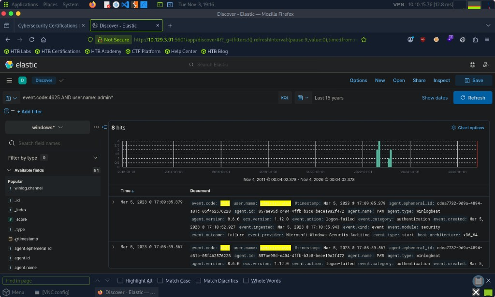

# Windows Failed Logon Investigation (Event 4625)

## Overview

* **Objective:** Investigate failed authentication for accounts matching `admin*` and record the host, agent, and event fields that support the lead.
* **Platform:** Hack The Box lab, reached over the HTB VPN and a VNC Linux desktop.
* **SIEM:** Kibana Discover on the lab Elastic stack (`http://10.129.3.91:5601`), data view `windows*`.
* **Shipper:** Winlogbeat 8.6.0 on host `PAW`.
* **Target event:** Windows Security log, Event ID **4625** (an account failed to log on), provider `Microsoft-Windows-Security-Auditing`.

## Access path

The screenshot is the session, top to bottom:

| Layer | What is on screen | Role |
| --- | --- | --- |
| Platform | Hack The Box bookmarks: Labs, Certifications, Academy, CTF Platform, Help Center, Blog | Lab platform |
| VPN | `VPN - 10.10.15.76 (12.8 ms)` | HTB VPN client address for this session |
| Remote desktop | Panel entry `[VNC config]` on a Linux desktop (Applications, Places, System) | Console used to reach the lab VM |
| Browser | Mozilla Firefox, tab title `Discover - Elastic` | Client to Kibana. A second tab is open on Cybersecurity Certifications |
| SIEM | Kibana Discover, `http://10.129.3.91:5601/app/discover`, marked Not Secure | Lab Kibana on port 5601, plain HTTP inside the lab network |
| Data view | `windows*`, 81 available fields, popular field `winlog.channel` | Winlogbeat-backed Windows logs |
| Endpoint telemetry | `agent.name: PAW`, `agent.type: winlogbeat`, `agent.version: 8.6.0` | Host that produced the 4625 events |

`10.129.3.91` and `10.10.15.76` are addresses for this lab instance and this VPN session. They are documented because they identify the path in the screenshot.

## Tool stack

| Tool | Type | Version or detail in this lab | Where it shows up |
| --- | --- | --- | --- |
| Hack The Box | Lab platform | Labs, Academy, Certifications, CTF | Firefox bookmarks |
| HTB VPN | Remote access | Client `10.10.15.76`, 12.8 ms | Desktop panel |
| VNC | Remote console | `[VNC config]` on the panel | Desktop panel |
| Linux desktop | Analyst VM session | Applications, Places, System | Desktop menu |
| Mozilla Firefox | Browser | Page title `Discover - Elastic — Mozilla Firefox` | Browser chrome |
| Kibana Discover | SIEM UI | Lab host port `5601`, KQL selected | `10.129.3.91` |
| Elasticsearch | Lab data store | Not drawn as its own page. Kibana is querying it | Behind Discover |
| Winlogbeat | Log shipper | 8.6.0 | `agent.version`, `agent.type` |
| Elastic Common Schema | Event schema | 1.12.0 | `ecs.version` |
| KQL | Query language | Selected in the query bar | Kibana language menu |
| Windows Security auditing | Log source | Provider `Microsoft-Windows-Security-Auditing` | `event.provider` |

Elastic here is the stack installed in the lab, opened by IP and port. It is not an Elastic Cloud tenant.

## Question

Which failed sign-ins in `windows*` target account names matching `admin*`, which host reported them, and which fields in the opened documents are enough to keep or drop a brute-force lead?

## Query

Data view `windows*`. Language KQL. Time picker **Last 15 years**, rendered as:

`Nov 4, 2011 @ 00:04:02.378` → `Nov 4, 2026 @ 00:04:02.378`

```kql
event.code:4625 AND user.name: admin*
```

Discover returned **8 hits**. The chart has two bars, both in 2023. Saved copy: [`../../queries/event-4625-admin-failed-logon.kql`](../../queries/event-4625-admin-failed-logon.kql).

The wide window is what produced the 8 hits. The events themselves sit on 5 Mar 2023, so a follow-up pass can shrink the picker to that day once the extra fields are open.

## Evidence



Kibana's highlight is on `event.code` and `user.name` because those terms are in the query. The account string stays in the screenshot and is not copied into this note.

## Documents opened

Rows are sorted by time, newest first. Both rows are the same agent.

| Field | 5 Mar 2023 @ 17:09:05.379 | 5 Mar 2023 @ 17:08:59.567 |
| --- | --- | --- |
| `event.code` | 4625 | 4625 |
| `user.name` | matches `admin*` (highlighted) | matches `admin*` (highlighted) |
| `@timestamp` | 5 Mar 2023 @ 17:09:05.379 | 5 Mar 2023 @ 17:08:59.567 |
| `agent.ephemeral_id` | `cdea7782-9d9a-4894-a81c-85f462576228` | same |
| `agent.id` | `857ae95d-c484-4ffb-b3c0-bece19a2f472` | same |
| `agent.name` | `PAW` | `PAW` |
| `agent.type` | `winlogbeat` | `winlogbeat` |
| `agent.version` | `8.6.0` | `8.6.0` |
| `ecs.version` | `1.12.0` | `1.12.0` |
| `event.action` | `logon-failed` | `logon-failed` |
| `event.category` | `authentication` | `authentication` |
| `event.created` | 5 Mar 2023 @ 17:10:52.927 | starts `Mar 5, 2023`; the rest of the row is clipped |
| `event.ingested` | 5 Mar 2023 @ 17:10:55.943 | clipped |
| `event.kind` | `event` | clipped |
| `event.module` | `security` | clipped |
| `event.outcome` | `failure` | clipped |
| `event.provider` | `Microsoft-Windows-Security-Auditing` | clipped |
| `event.type` | `start` | clipped |
| `host.architecture` | `x86_64` | clipped |

The two opened timestamps are **5.812 seconds** apart. Shared `agent.id` and `agent.ephemeral_id` mean one Winlogbeat enrollment and one running agent process, not two collectors.

On the 17:09:05 event, `@timestamp` is 17:09:05.379, `event.created` is 17:10:52.927, and `event.ingested` is 17:10:55.943. The logon time to use is `@timestamp`. The later two fields are shipper and ingest time (about 1 minute 48 seconds, then about 3 seconds).

`event.action: logon-failed`, `event.category: authentication`, `event.outcome: failure`, and `event.type: start` are the ECS shape Winlogbeat uses for a failed logon. `event.provider` ties that shape to the Windows Security channel. `winlog.channel` is listed among the popular fields and was not expanded in the row.

## Timeline

| Time | What the capture shows |
| --- | --- |
| 5 Mar 2023 @ 17:08:59.567 | Failed logon, `admin*` account, host `PAW`, Winlogbeat 8.6.0 |
| 5 Mar 2023 @ 17:09:05.379 | Second failed logon, same agent, same host |
| 5 Mar 2023 @ 17:10:52.927 | First event's `event.created` |
| 5 Mar 2023 @ 17:10:55.943 | First event's `event.ingested` |
| 2023 (histogram) | Both chart bars. All 8 hits fall in this cluster |
| 3 Nov 2026 @ 19:16 | Discover session in the screenshot. Picker set to Last 15 years |

## Assessment

Eight Security-log failures for `admin*` account names were reported by host `PAW`. Two of those failures are six seconds apart on the same agent. `PAW` is a privileged access workstation name, so the account pattern and the host class both point at privileged access rather than a random user desktop.

That is a real lead. It is a small one. Eight documents, with two of them opened, do not show a source address, a logon type, or a failure status. Password guessing, a person retyping a password, and a scheduled task with a stale admin credential all look the same until `SubStatus`, `LogonType`, and `IpAddress` are read.

## Fields to open next

These names are the usual Winlogbeat 8.x fields for a 4625. They were inside the 81 available fields and were not expanded in this screenshot. Confirm the path in Available fields before filtering on it.

| Field | What it decides |
| --- | --- |
| `winlog.event_data.TargetUserName` | Exact account, compared with the highlighted `user.name` |
| `winlog.event_data.TargetDomainName` | Domain account or local account |
| `winlog.event_data.LogonType` | Interactive, network, service, RDP, or another type |
| `winlog.event_data.Status` and `SubStatus` | Bad password, unknown user, disabled, locked, or another reason |
| `winlog.event_data.IpAddress` | Origin, when the logon type carries one |
| `winlog.event_data.WorkstationName` | Caller computer name |
| `winlog.event_data.FailureReason` | Text reason Windows stored beside the status code |
| `source.ip` | ECS copy of the source, if Winlogbeat mapped it |
| `host.name` | Host name beside `agent.name` |
| `winlog.channel` | Should be `Security` for provider `Microsoft-Windows-Security-Auditing` |

Status and substatus values below are the Microsoft key for 4625. None of them were read from these two documents.

| Code | Meaning |
| --- | --- |
| `0xC0000064` | User name does not exist |
| `0xC000006A` | User name is correct, password is wrong |
| `0xC000006D` | Bad user name or authentication information |
| `0xC000006E` | Account restriction. The credentials were valid and another restriction blocked the logon |
| `0xC000006F` | Logon outside allowed hours |
| `0xC0000070` | Workstation restriction |
| `0xC0000071` | Password expired |
| `0xC0000072` | Account disabled |
| `0xC000015B` | Requested logon type not granted |
| `0xC0000193` | Account expired |
| `0xC0000234` | Account locked out |

| Logon type | Meaning |
| --- | --- |
| 2 | Interactive (console) |
| 3 | Network (SMB, WinRM, mapped drive) |
| 4 | Batch |
| 5 | Service |
| 7 | Unlock |
| 8 | Network cleartext |
| 9 | New credentials (RunAs) |
| 10 | Remote interactive (RDP) |
| 11 | Cached interactive |

A short gap plus logon type 3 or 10 and substatus `0xC000006A`, grouped by one source IP, is the shape that supports password guessing. Unknown user (`0xC0000064`) on many names is password spraying. A single workstation and a handful of failures is often a bad saved credential. That split waits on the columns above.

## ATT&CK

| ID | Name | Mapping |
| --- | --- | --- |
| T1110 | Brute Force | Hypothesis. Repeated 4625s for `admin*` on one host. Volume in view is 8. |
| T1110.001 | Password Guessing | Fits only if the next pivot shows a real account and a wrong password from one source. |
| T1110.003 | Password Spraying | Fits only if the next pivot shows many account names and "user does not exist" or a single password attempt across them. |
| T1078 | Valid Accounts | The hunt targeted administrative-style names. No successful logon (4624) was queried in this pass. |
| — | Data source | Windows Security log, Event 4625, via Winlogbeat into Elasticsearch. |

## Reproduce

1. Connect to the lab the same way: HTB VPN, VNC session, Firefox.
2. Open Kibana Discover on port 5601 and select data view `windows*`.
3. Set the language to KQL and the time picker to Last 15 years (or to 5 Mar 2023 once the window is confirmed).
4. Run `event.code:4625 AND user.name: admin*`.
5. Expand a hit and read `agent.name`, `event.action`, `event.outcome`, and `event.provider` before treating the chart count as the finding.
6. Add the columns in [Fields to open next](#fields-to-open-next), then narrow or keep the brute-force lead from status, logon type, and source.
