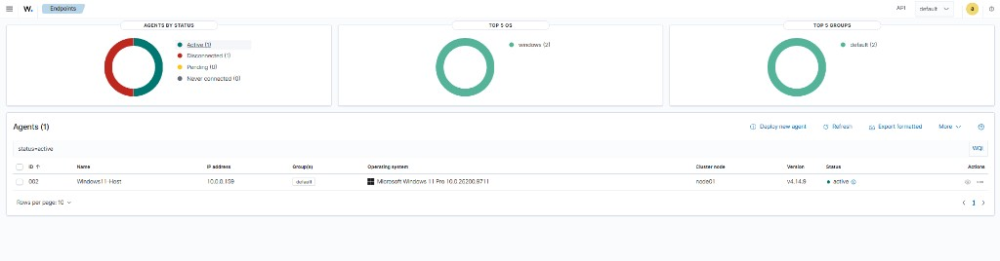
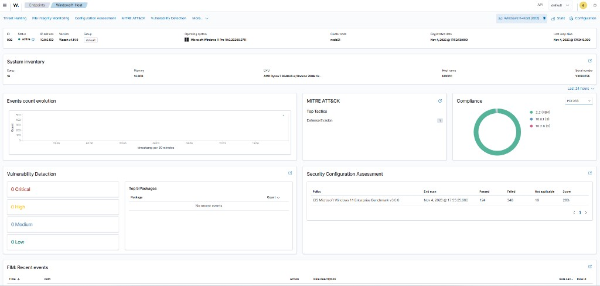
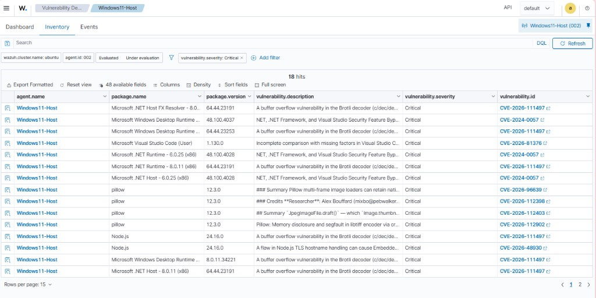

# Wazuh — Windows 11 agent and critical vulnerabilities

## Stack

Hyper-V console on host `UDOPC`. Ubuntu guest runs the Wazuh server. The Windows 11 machine (`UDOPC`, Ryzen 7 8840HS, 16 cores, 15.8 GB) runs the agent.

| Component | Service | Evidence |
| --- | --- | --- |
| Wazuh manager | `wazuh-manager.service` active since 4 Nov 2026 17:59:29 UTC. About 1.4 GB RAM, 273 tasks | [manager](../../evidence/wazuh-manager-status.png) |
| Wazuh indexer | `wazuh-indexer.service` active since 17:53:49 UTC. Java / OpenSearch, main PID 18458, about 1.1 GB RAM | [indexer](../../evidence/wazuh-indexer-status.png) |
| Wazuh dashboard | `wazuh-dashboard.service` active since 17:59:32 UTC. Node, main PID 73458, about 179 MB RAM | [indexer and dashboard](../../evidence/wazuh-indexer-and-dashboard-status.png) |
| Docs link on the unit | https://documentation.wazuh.com | indexer status |

Manager child processes that were up: `wazuh-apid`, `wazuh-authd`, `wazuh-db`, `wazuh-execd`, `wazuh-analysisd`, `wazuh-syscheckd`, `wazuh-remoted`, `wazuh-logcollector`, `wazuh-monitord`, `wazuh-modulesd` (router, content_manager, inventory-harvester).

Indexer log on screen: `System::setSecurityManager` deprecation and a COMPAT locale-provider warning. Both are JVM startup warnings, not an agent finding.

## Agent

| Field | Value |
| --- | --- |
| ID / name | 002 / `Windows11-Host` |
| Address | `10.0.0.159` |
| OS | Microsoft Windows 11 Pro `10.0.26200.5711` |
| Group | `default` |
| Cluster | name `ubuntu`, node `node01` |
| Registered | 4 Nov 2026 17:52:50 |
| Last keep-alive | 4 Nov 2026 17:59:16 |
| Status counts | Active 1, Disconnected 1. Top OS and group both show 2 Windows agents in `default` |

On that overview: MITRE top tactic **Defense Evasion** (5). PCI DSS chart is on the same page. FIM recent events table was empty. Vulnerability cards on the overview read 0. The inventory view below is the package list.

## Critical vulnerabilities

Inventory for agent 002, severity Critical: **18 hits**. Filter: `wazuh.cluster.name: ubuntu`, `agent.id: 002`, plus Evaluated and Under evaluation.

15 rows were on the page:

| Package | Version on screen | CVE |
| --- | --- | --- |
| Microsoft .NET Host FX Resolver | 8.0.x, build 64.44.23191 | CVE-2026-111497 |
| Microsoft Windows Desktop Runtime | 48.100.4037 | CVE-2024-0057 |
| Microsoft Windows Desktop Runtime | 64.44.23253 | CVE-2026-111497 |
| Microsoft Visual Studio Code (User) | 1.13.0 | CVE-2026-81376 |
| Microsoft .NET Runtime 8.0.25 (x86) | 48.100.4028 | CVE-2024-0057 |
| Microsoft .NET Runtime 8.0.11 (x86) | 64.44.23191 | CVE-2026-111497 |
| Microsoft .NET Runtime 6.0.25 (x86) | 48.100.4028 | CVE-2024-0057 |
| pillow | 12.3.0 | CVE-2026-96639, CVE-2026-112938, CVE-2026-112403, CVE-2026-112902 |
| Node.js | 24.16.0 | CVE-2026-111497, CVE-2026-48930 |
| Microsoft Windows Desktop Runtime | 8.0.11.34221 | CVE-2026-111497 |
| Microsoft .NET Host 8.0.11 (x86) | 64.44.23191 | CVE-2026-111497 |

Descriptions on screen: Brotli decoder buffer overflow (CVE-2026-111497), .NET / Visual Studio security feature bypass (CVE-2024-0057), incomplete comparison in Visual Studio Code (CVE-2026-81376), Pillow image-loader and libtiff issues, Node.js TLS hostname handling (CVE-2026-48930). Three hits were on the next page and are not listed here.

## Configuration assessment

Same agent page. Policy **CIS Microsoft Windows 11 Enterprise Benchmark v3.0.0**. Scan ended 4 Nov 2026 17:59:25.

| Passed | Failed | Not applicable | Score |
| --- | --- | --- | --- |
| 124 | 348 | 10 | 26% |
