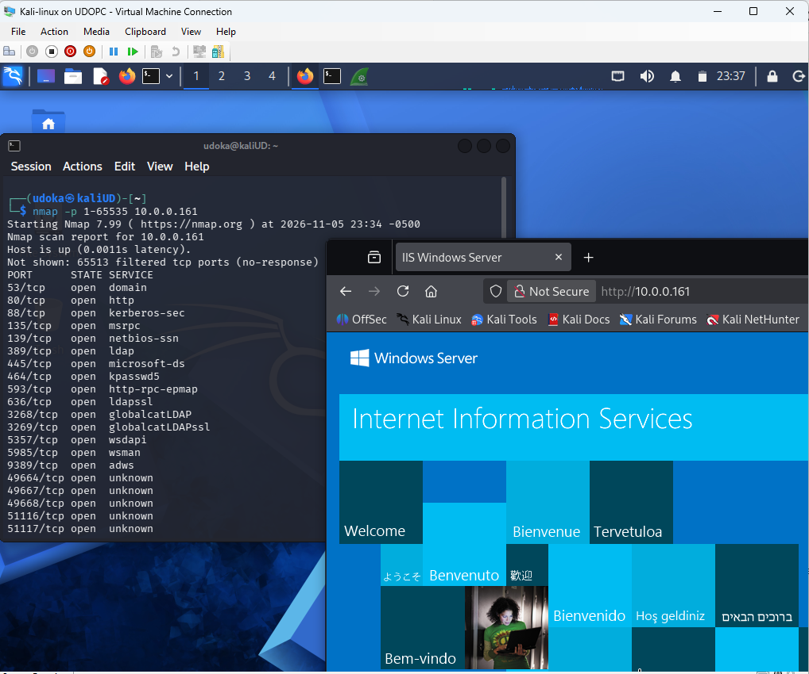
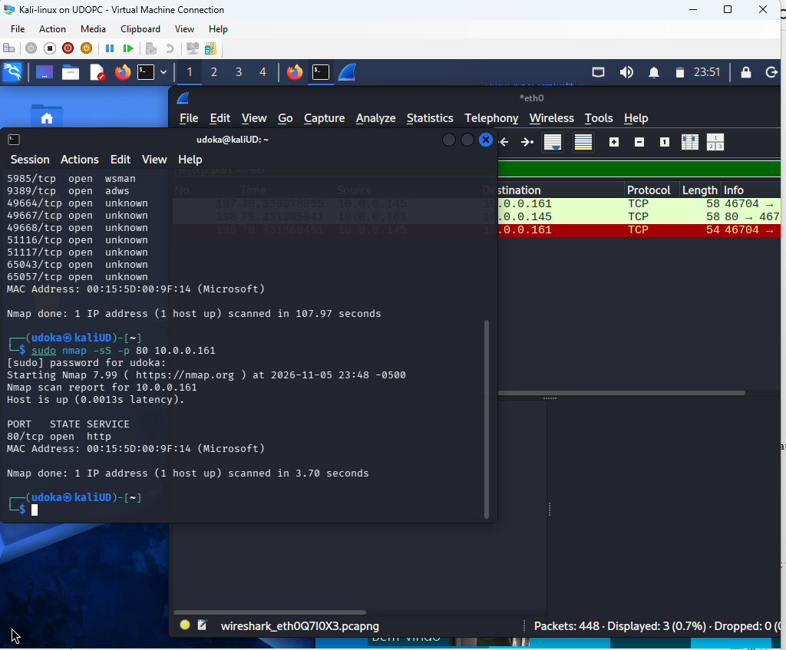
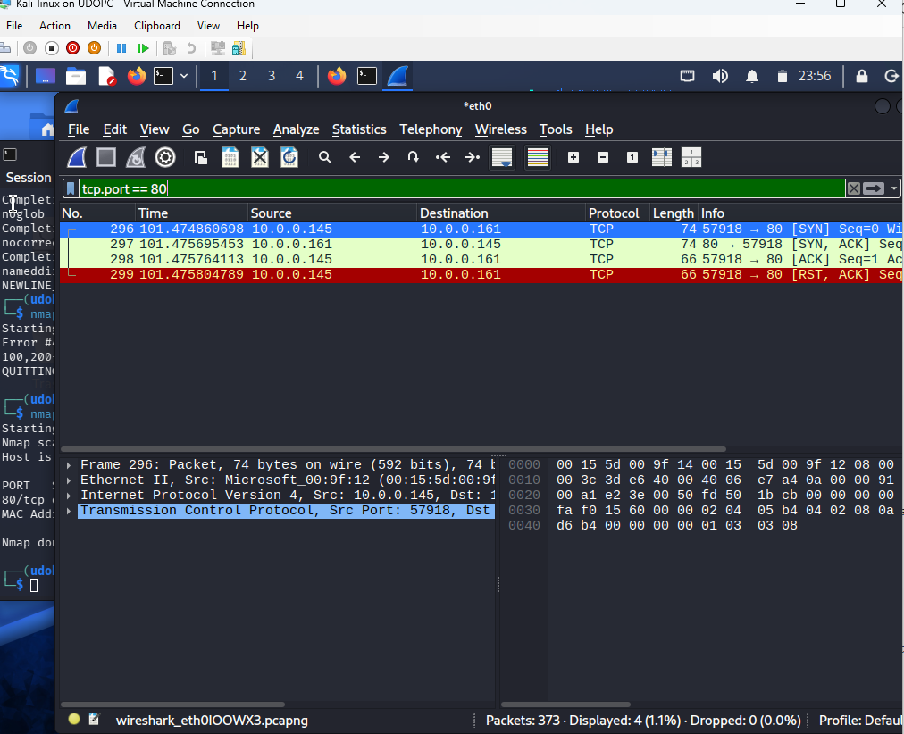
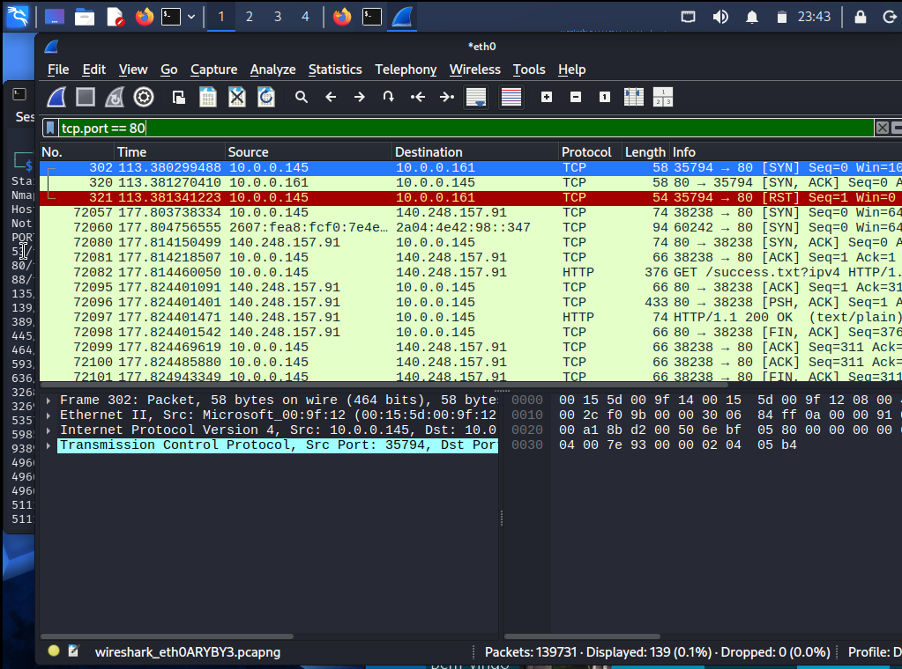

# Nmap and Wireshark scan patterns

Kali guest `kaliUD` on Hyper-V host `UDOPC`. Target `10.0.0.161` is a Windows Server (IIS) on a Hyper-V NIC, MAC `00:15:5D:00:9F:14`. Scanner address in the captures is `10.0.0.145`.

| Tool | Role |
| --- | --- |
| Hyper-V Virtual Machine Connection | Console for the Kali guest |
| Nmap 7.99 | Port and service discovery |
| Wireshark | Capture on `eth0`, display filter `tcp.port == 80` |
| Firefox | Loaded the IIS page on port 80 |

## 1. Open ports

`nmap -p 1-65535 10.0.0.161` at 23:34. Host is up. 65,513 TCP ports filtered. Open services:

| Port | Service |
| --- | --- |
| 53 | domain |
| 80 | http |
| 88 | kerberos-sec |
| 135 | msrpc |
| 139 | netbios-ssn |
| 389 | ldap |
| 445 | microsoft-ds |
| 464 | kpasswd5 |
| 593 | http-rpc-epmap |
| 636 | ldapssl |
| 3268 | globalcatLDAP |
| 3269 | globalcatLDAPssl |
| 5357 | wsdapi |
| 5985 | wsman |
| 9389 | adws |
| 49664, 49667, 49668, 51116, 51117 | unknown |

Port 80 answered in Firefox at `http://10.0.0.161` with the IIS Windows Server page.

## 2. Half-open SYN scan (`-sS`)

`sudo nmap -sS -p 80 10.0.0.161` at 23:48. One host, 3.70 seconds. Port 80/tcp open, service http.

`-sS` sends a SYN and does not complete the handshake. Wireshark on this run shows short TCP frames only (lengths 54–74) between `10.0.0.145` and `10.0.0.161`, including the reset. An earlier pass in the same terminal listed the high ports from section 1 (5985, 9389, 49664 and the rest) and took 107.97 seconds.

The filtered capture of that pattern, source port 35794:

| Order | Direction | Flags |
| --- | --- | --- |
| 1 | `10.0.0.145` → `10.0.0.161:80` | SYN |
| 2 | `10.0.0.161` → `10.0.0.145` | SYN, ACK |
| 3 | `10.0.0.145` → `10.0.0.161` | RST |

No final ACK. The scanner resets as soon as the SYN-ACK proves the port is open. Several of these exchanges sit within the same second. That is the short burst.

## 3. Full connection

The other handshake to port 80 uses source port 57918 and includes the third step:

| Order | Direction | Flags | Bytes |
| --- | --- | --- | --- |
| 1 | `10.0.0.145:57918` → `10.0.0.161:80` | SYN | 74 |
| 2 | `10.0.0.161:80` → `10.0.0.145:57918` | SYN, ACK | 74 |
| 3 | `10.0.0.145:57918` → `10.0.0.161:80` | ACK | 66 |
| 4 | `10.0.0.145:57918` → `10.0.0.161:80` | RST, ACK | 66 |

The ACK completes the connection. `-sT` is this pattern: the local TCP stack finishes the handshake, then the socket is closed. `-sS` stops one packet earlier and sends RST instead of ACK.

## 4. Scan traffic next to browsing

Display filter `tcp.port == 80` in the burst capture holds both patterns.

The scan rows are flag-only frames: SYN, SYN-ACK, RST, no HTTP. The browsing rows are a real session from `140.248.157.91` to `10.0.0.145:80`:

- `GET /success.txt?ipv4` HTTP/1.1
- `HTTP/1.1 200 OK` (text/plain)
- ACK, then FIN, ACK to close

A scan is a burst of handshake flags and a reset. Browsing carries an HTTP request and response, then a FIN close.

