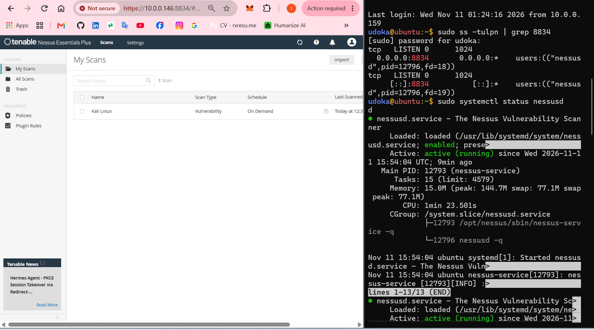
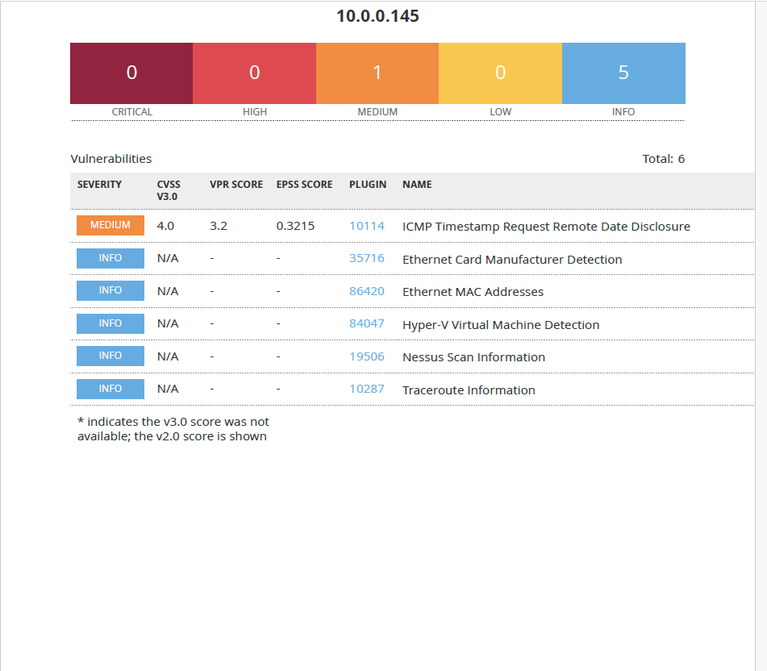
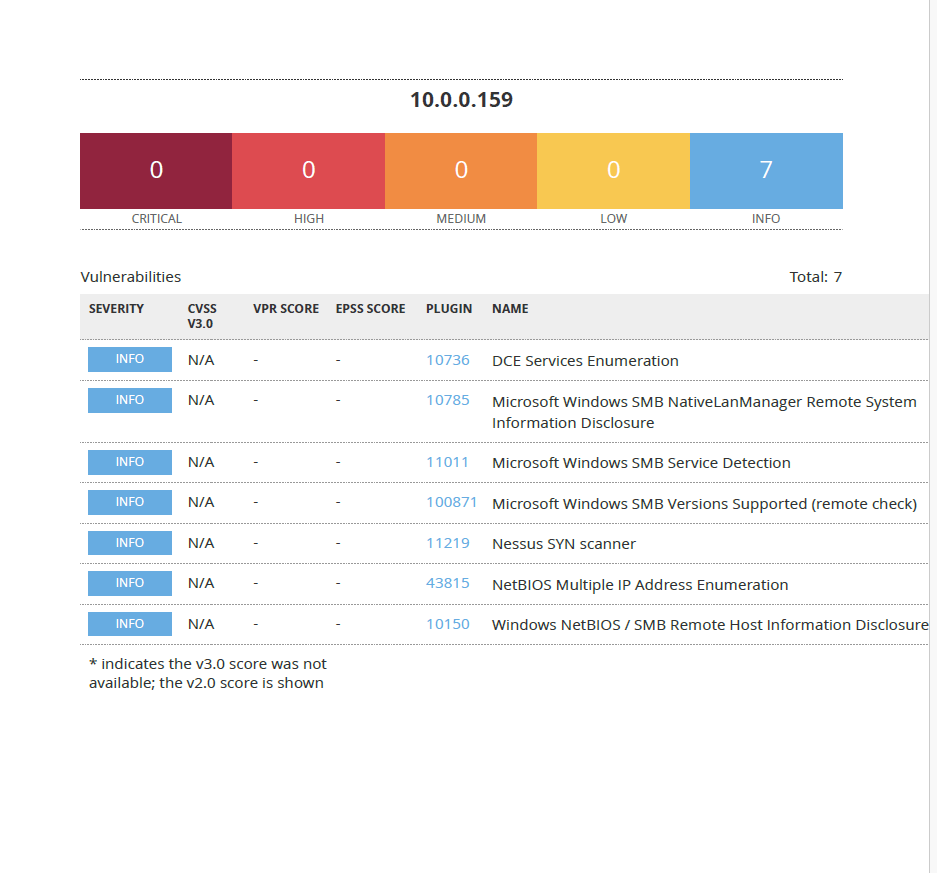
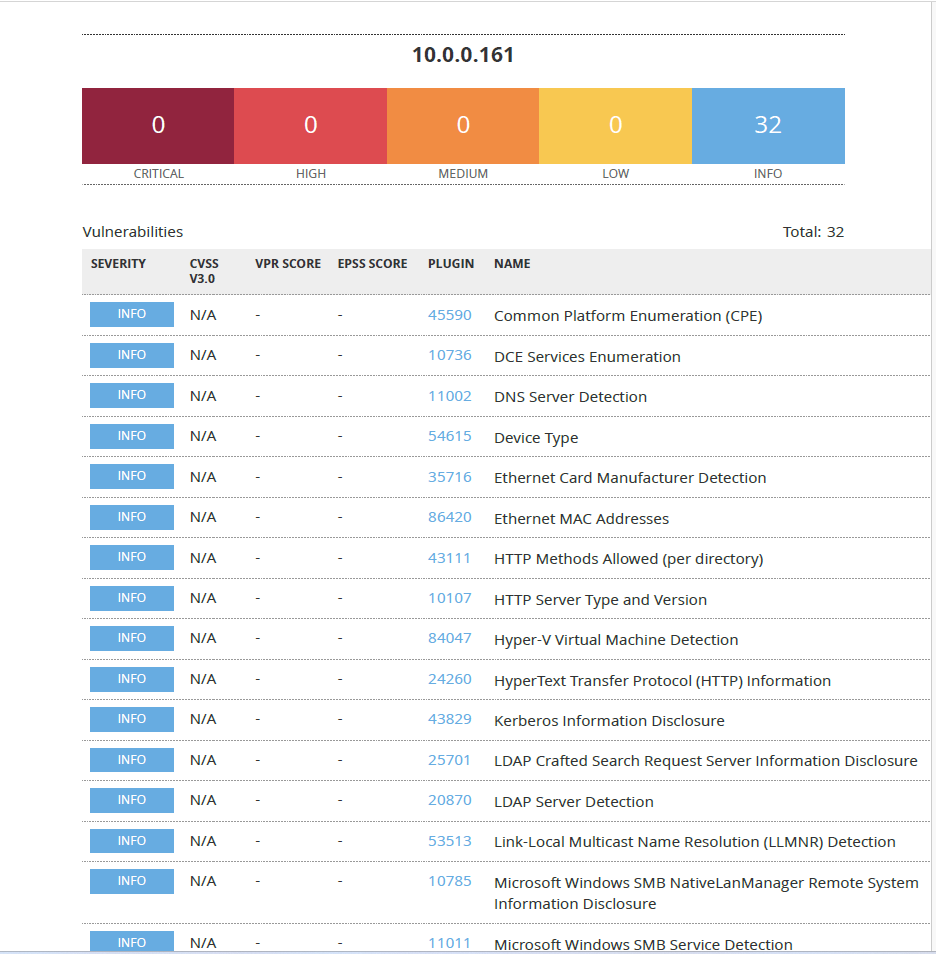

# Nessus — deployment, scanning and reporting

## 1. Scanner deployment and verification

I verified `nessusd` was running on Ubuntu using `sudo systemctl status nessusd` and `sudo ss -tulnp | grep 8834`. The web console was reachable on TCP 8834 and displayed an on-demand Kali Linux scan. The console certificate warning is separate from target findings.

## 2. Kali Linux — 10.0.0.145

I scanned Kali from Ubuntu and identified one medium finding (ICMP timestamp disclosure, CVSS 4.0, VPR 3.2, EPSS 0.3215) and five informational findings, including MAC, Hyper-V and traceroute information.

## 3. Windows 11 host — 10.0.0.159

I reviewed seven informational findings covering DCE/RPC, SMB, NetBIOS and SYN scanning. I used these observations to assess unnecessary network exposure.

## 4. Windows Server 2022 — 10.0.0.161

I reviewed the summary of 32 informational findings, including DNS, HTTP, Kerberos, LDAP and SMB. The screenshot shows only part of the plugin list.

## 5. Assessment and remediation reporting

| Target | Critical | High | Medium | Low | Info | Total |
| --- | ---: | ---: | ---: | ---: | ---: | ---: |
| Kali Linux (`10.0.0.145`) | 0 | 0 | 1 | 0 | 5 | 6 |
| Windows 11 host (`10.0.0.159`) | 0 | 0 | 0 | 0 | 7 | 7 |
| Windows Server 2022 (`10.0.0.161`) | 0 | 0 | 0 | 0 | 32 | 32 |
| **Total** | **0** | **0** | **1** | **0** | **44** | **45** |

I prepared a [VA report](../reports/va-remediation-report.docx) and mapped its recommendations to the [visible scanner findings](remediation-mapping.md). The report describes proposed and reported actions; implementation and effectiveness are not independently verified by the screenshots.
