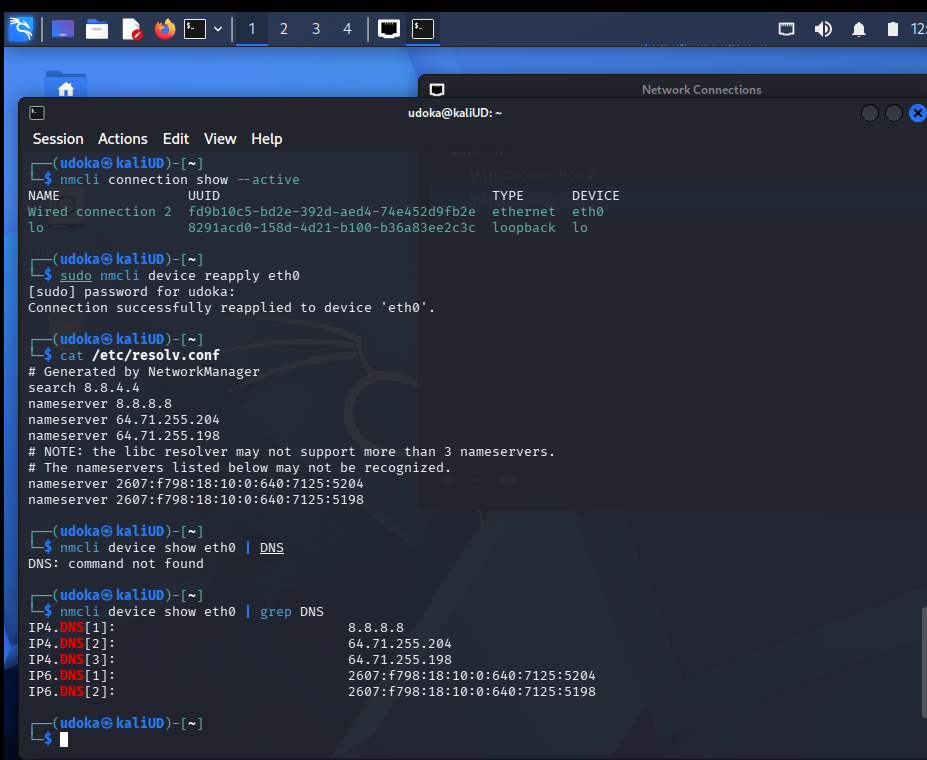
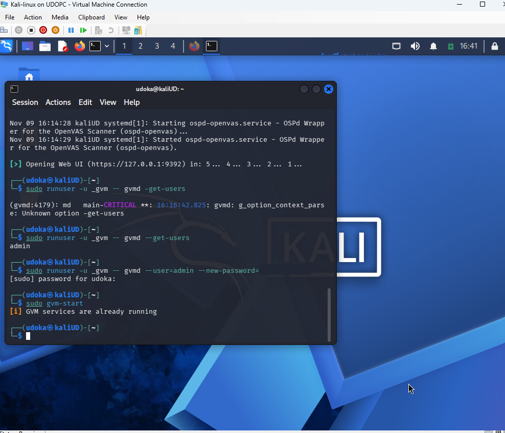
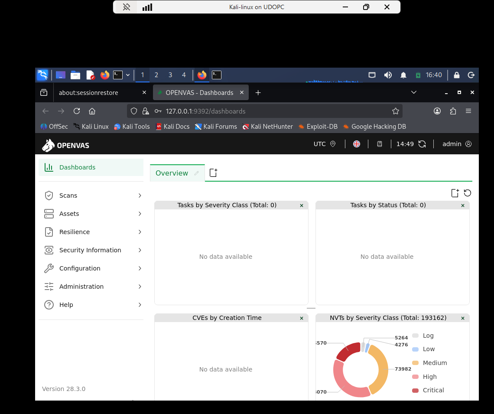
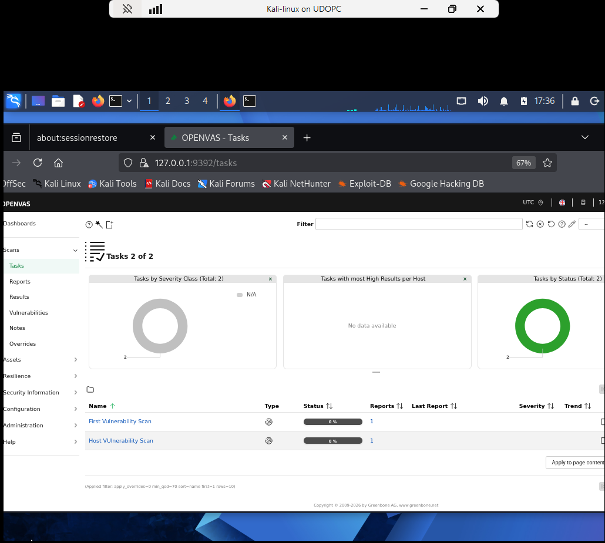
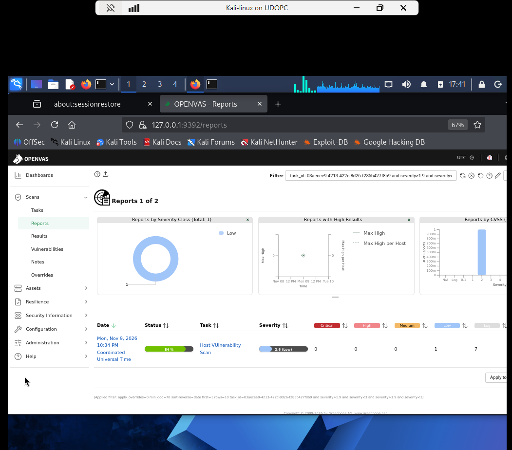
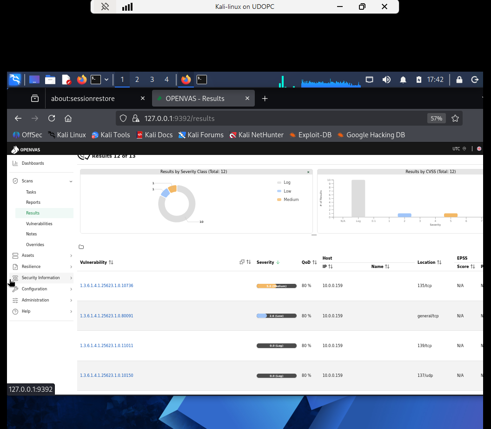
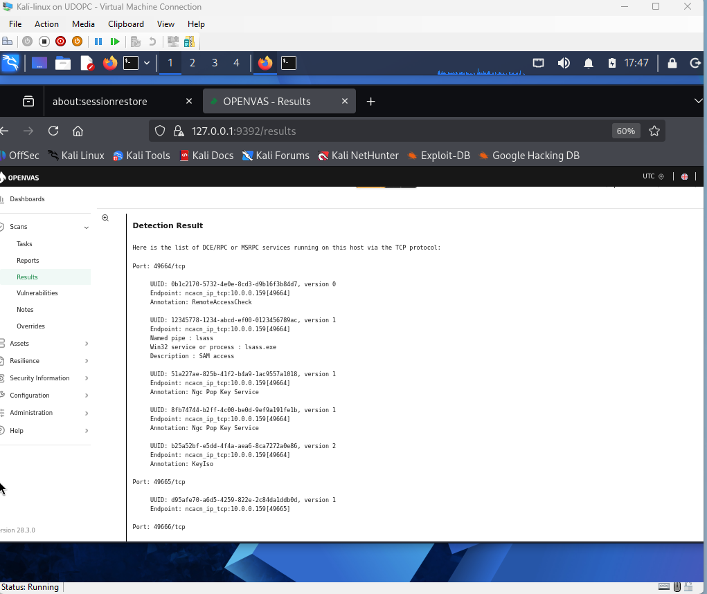
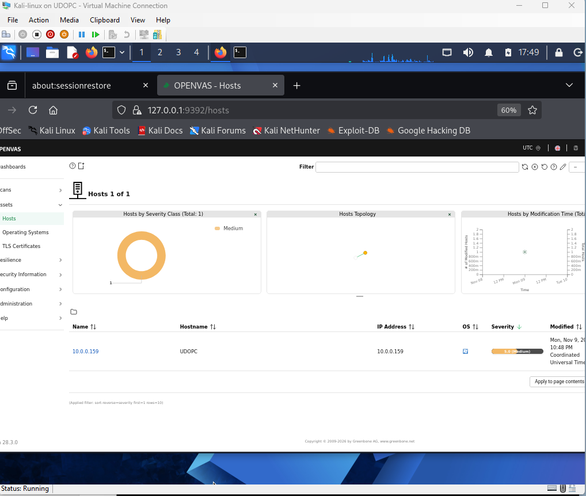
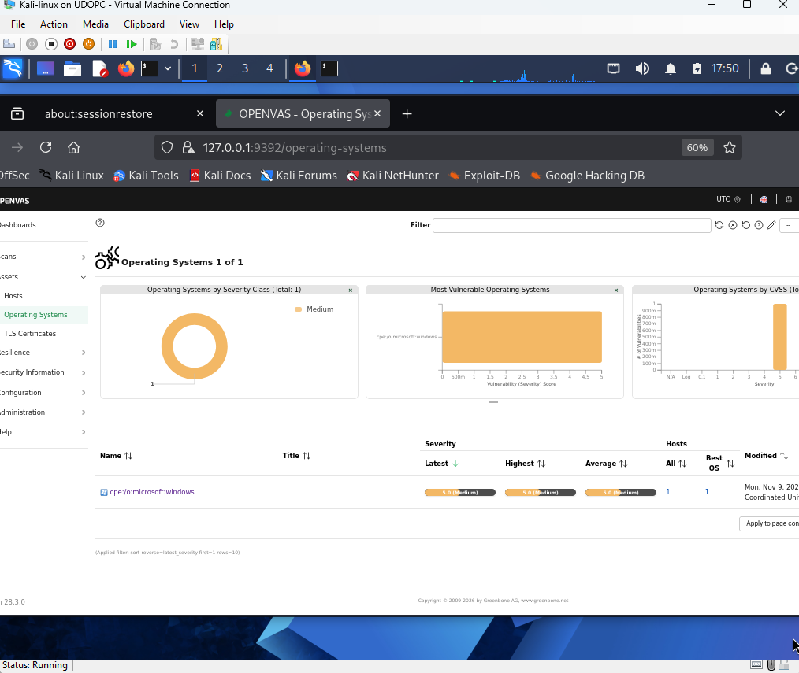

# GVM / OpenVAS on Kali — vulnerability assessment

**Objective:** Configure an OpenVAS scanner, assess a Windows lab host at `10.0.0.159`, and interpret the evidence in Greenbone reports.

## 1. Verify DNS and network access

I reapplied the Kali `eth0` connection with `nmcli`, then checked `/etc/resolv.conf` and the configured DNS addresses. This was a connectivity check before working with the scanner.

## 2. Start GVM and verify administrator access

I started GVM with `gvm-start`, checked the existing administrator account, and used the account-management command. The screenshot contains an initial **invalid CLI option** followed by the corrected option; the credential value is redacted for public sharing.

## 3. Check the dashboard and vulnerability-test feed

The Greenbone interface loaded at `127.0.0.1:9392` and displayed **193,162 NVTs** across severity categories. The dashboard showed **zero scan tasks** at this initial stage.

## 4. Create scan tasks

I created **First Vulnerability Scan** and **Host Vulnerability Scan**. The Tasks page displayed **2 of 2** tasks with the progress indicator at **0%** in this capture.

## 5. Review report progress

I opened the Host Vulnerability Scan report; the progress indicator showed **84%**, and its visible severity summary included a **low 2.6** result. I did not treat this as a completed report.

## 6. Filter and inspect scan results

The Results page showed **12 displayed entries** in the chart: **10 log/informational**, **1 low (2.6)**, and **1 medium (5.0)**. The list also indicated **12 of 13**, so the screenshot is a view of the available results, not proof of 13 verified vulnerabilities.

## 7. Examine DCE/RPC service detection

I inspected a discovery result listing DCE/RPC or MSRPC services on the Windows target, including high TCP ports. Service enumeration is useful exposure context, but does not establish exploitation.

## 8. Check the affected host

The Hosts view identified one host, **`10.0.0.159` (`UDOPC`)**, with a **medium severity rating of 5.0**.

## 9. Validate the operating-system grouping

The Operating Systems view grouped **one Windows host** under `cpe:/o:microsoft:windows`, showing **medium severity 5.0**.

## Assessment

This lab demonstrates installation, task setup, report review, and severity interpretation.