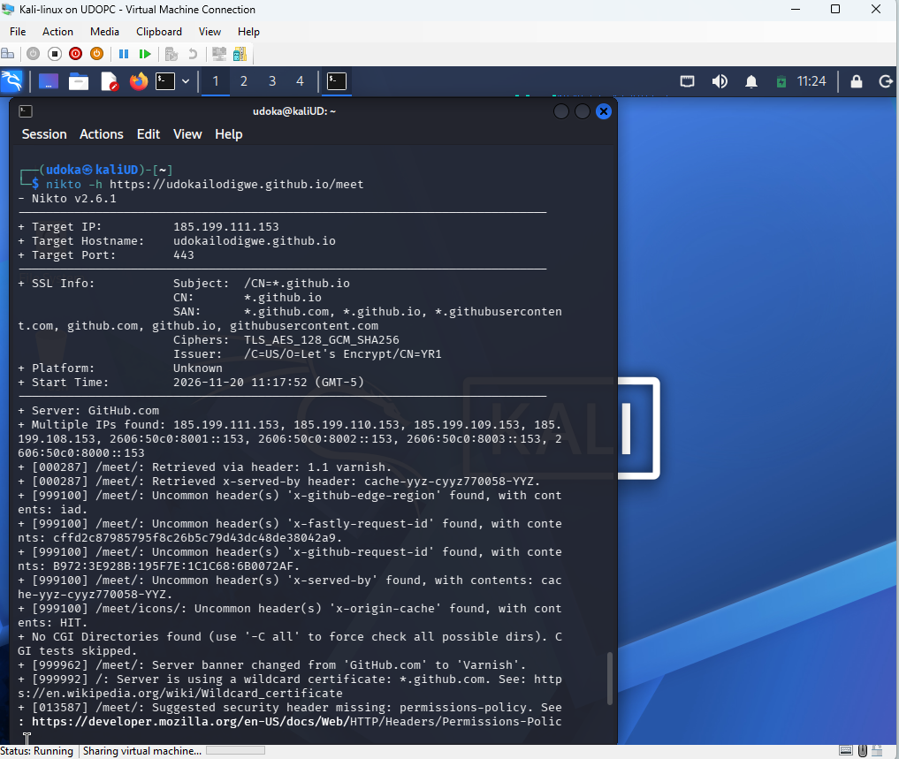
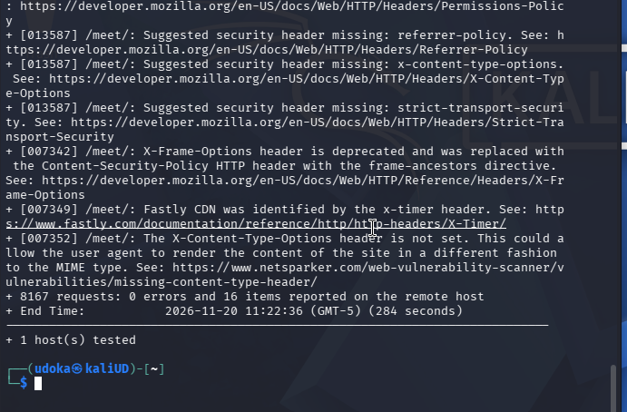
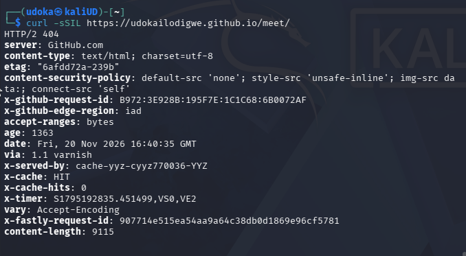
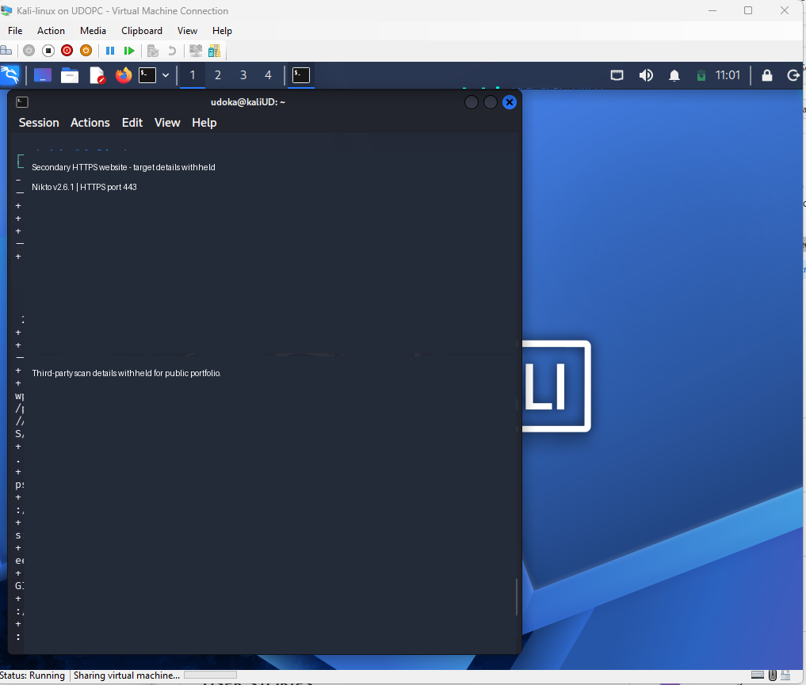

# Nikto assessment walkthrough

## Personal GitHub Pages website

### 1. Start the assessment

I ran Nikto against my personal GitHub Pages website. The scanner identified HTTPS, certificate details and hosting/CDN response metadata.

### 2. Review scan results

I reviewed the completed scan: 8,167 requests, zero errors, 16 reported items and a duration of 284 seconds. These items are scanner observations, not 16 confirmed vulnerabilities.

### 3. Validate the HTTP response

I used curl to inspect response headers. The `/meet/` path returned HTTP 404. This means the header observations cannot establish the security posture of the intended application. A valid application response would be needed for further validation.

## Secondary website

### 4. Review a separate scan

I ran a separate HTTPS web server assessment and reviewed the initial server and certificate information. The supplied screenshot shows partial output only; I did not establish a completed scan or confirmed vulnerability count from this evidence.

## Follow-up

I would validate observations against the intended application response and confirm the assessment scope before further testing. No remediation or retest is documented.
