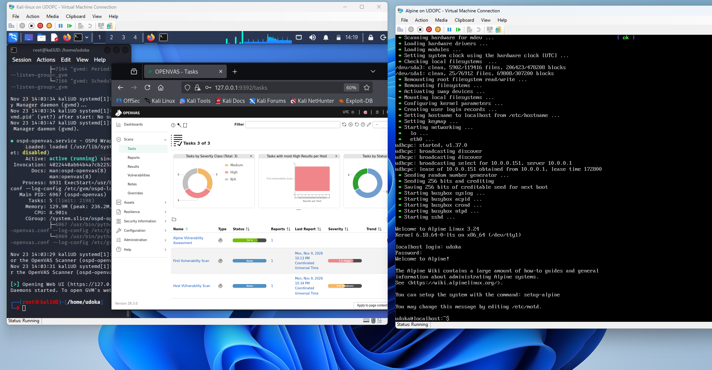
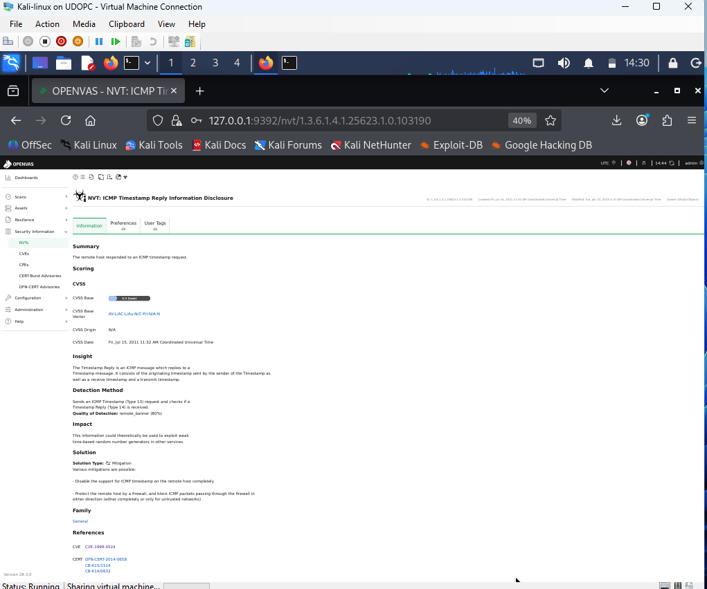
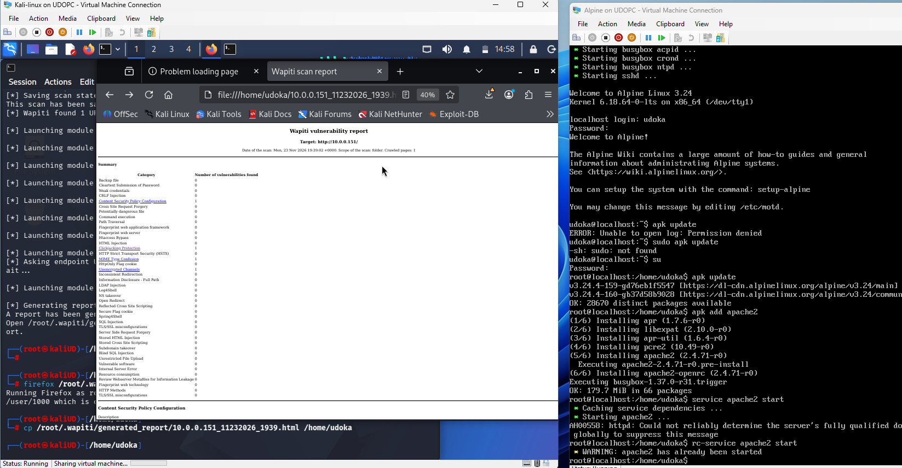
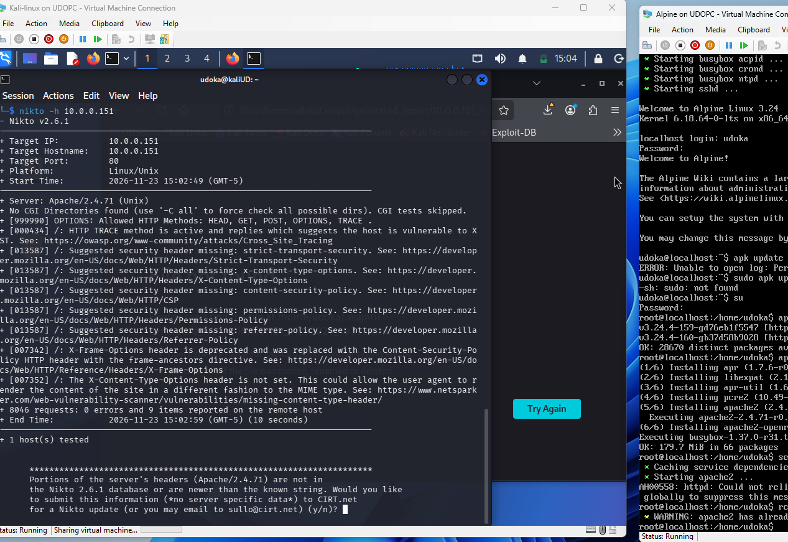
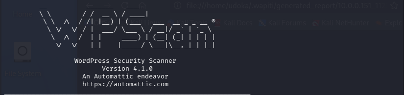
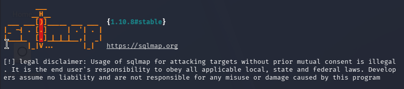

# Assessment walkthrough

## 1. Host assessment — OpenVAS
I started GVM on Kali and monitored the Alpine VM scan. The VM received 10.0.0.151 via DHCP; the task was at 74% when captured. Other completed tasks in the dashboard are not Alpine results.

I reviewed the ICMP timestamp reply information disclosure NVT, rated 2.1 (low), referencing CVE-1999-0524. The screenshot shows the test definition, not a host-specific completed finding.

## 2. Application assessment — Wapiti
I installed and started Apache on Alpine and reviewed the generated Wapiti HTML report. One page was crawled; five categories were flagged: CSP, clickjacking protection, HSTS, MIME-type confusion and unencrypted channels. No SQL injection or XSS was detected in this limited crawl.

## 3. Web server assessment — Nikto
I scanned the same Apache service on port 80. Nikto identified Apache 2.4.71 and reported nine items in ten seconds, including enabled TRACE and missing security headers. It issued 8,046 requests with zero errors. Exploitability was not established.

## 4. WordPress assessment — WPScan
I reviewed component discovery and configuration observations. Without an API token, the scan did not supply a CVE-based vulnerability inventory. I learned to distinguish component detection from verified vulnerabilities.

## 5. SQL injection assessment — SQLmap
I attempted automated injection testing. The run was inconclusive: unstable content and no testable input parameter prevented a reliable conclusion. A failed scan is not proof of security.

Third-party evidence is cropped for public disclosure; detailed target-specific results are not published here.
