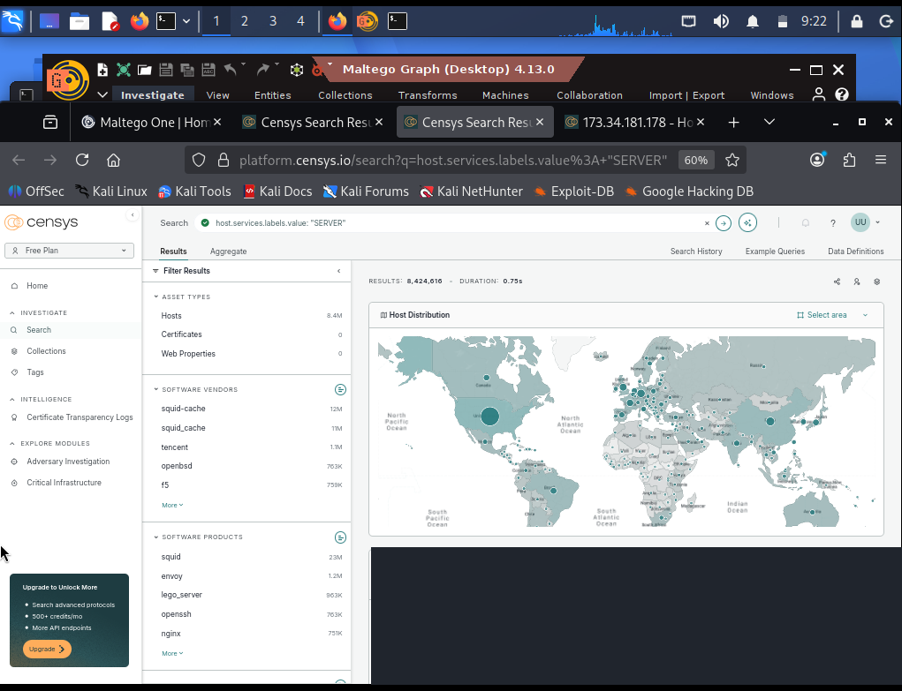
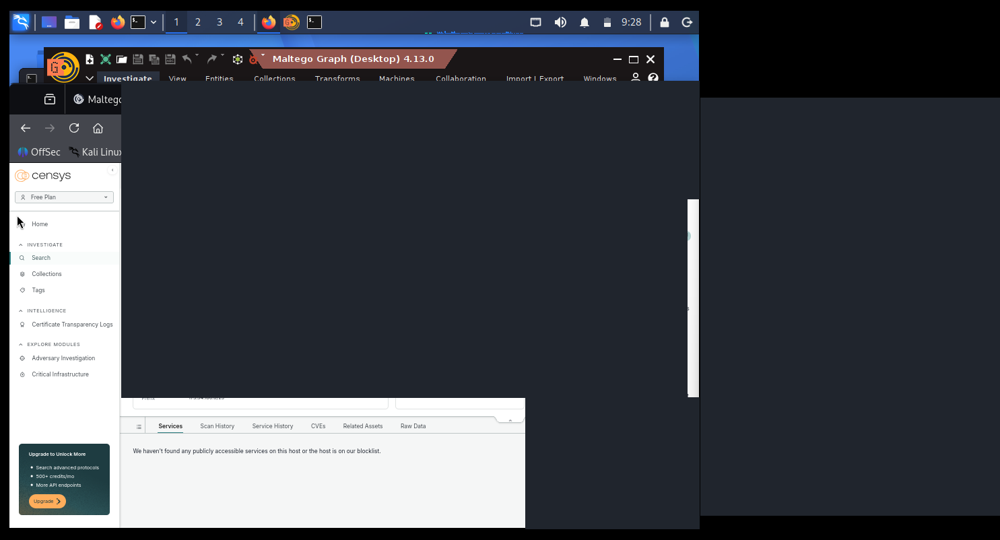
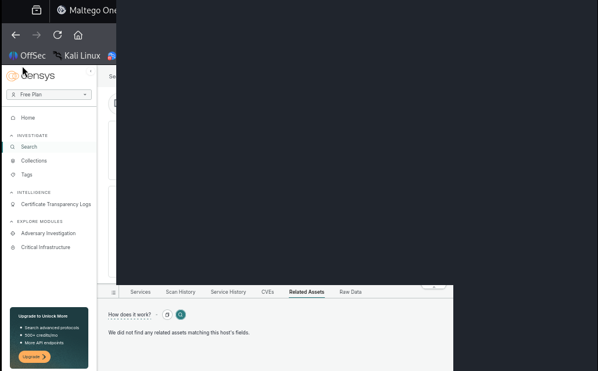
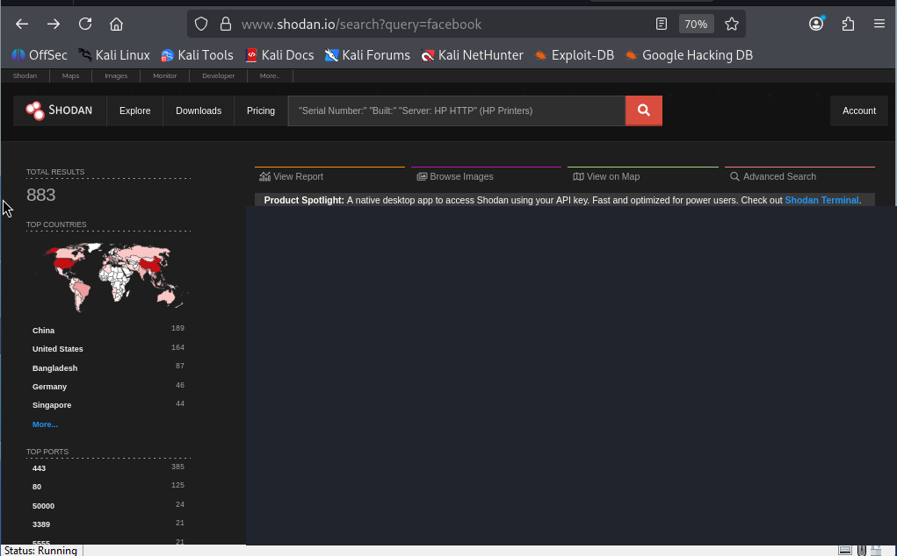
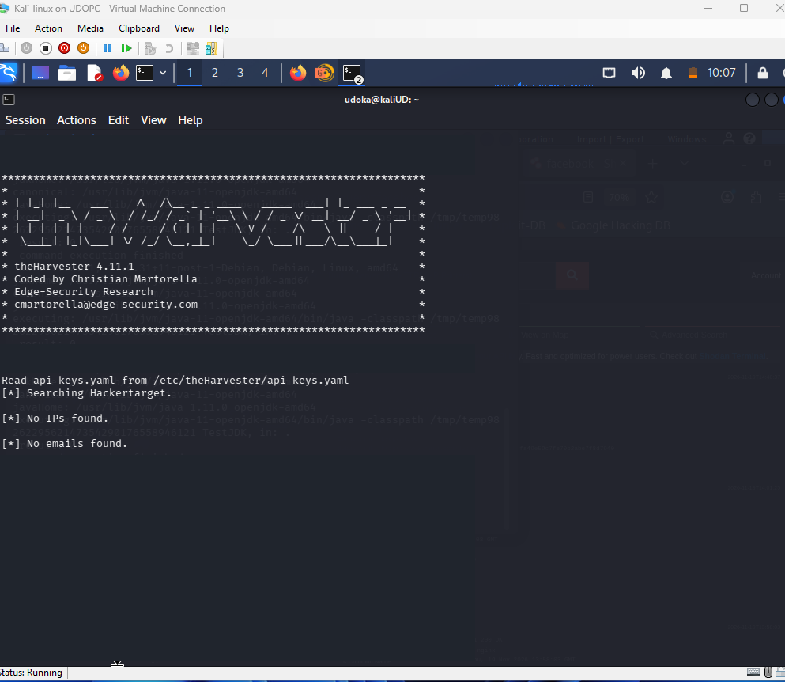
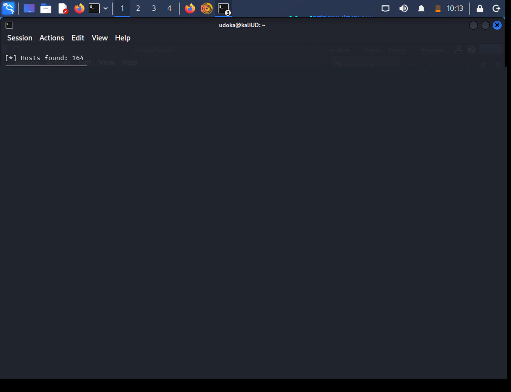
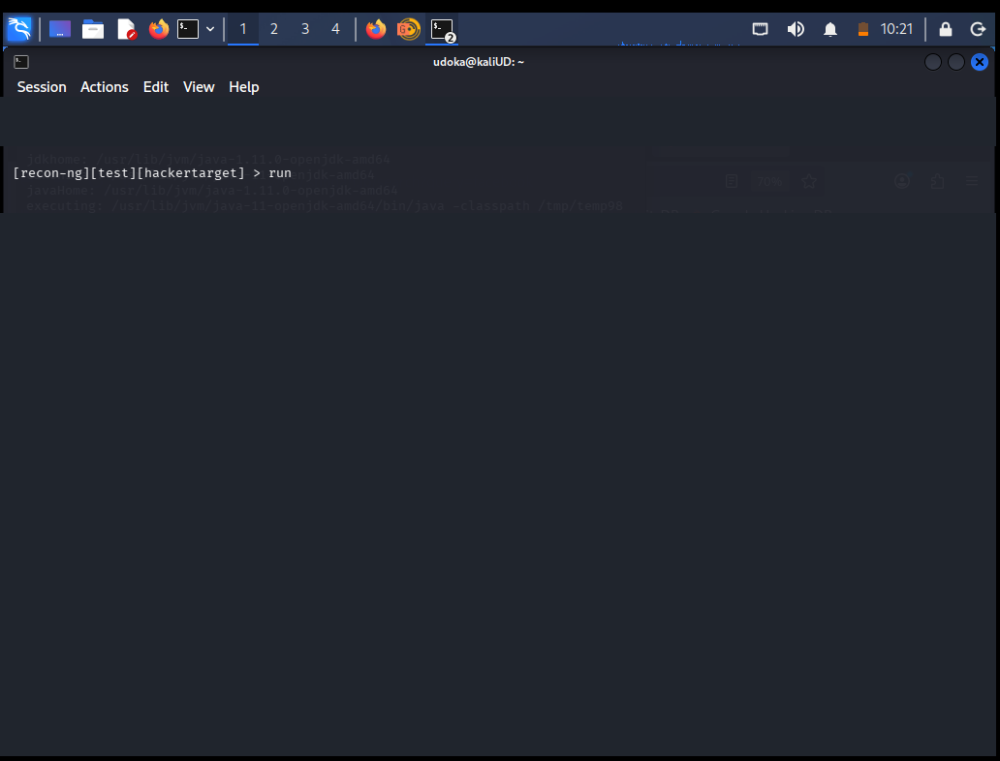

# Reconnaissance and enumeration walkthrough

## 1. Censys — asset discovery

I searched indexed server assets and reviewed the global distribution, software filters and service metadata.

## 2. Censys — public IP lookup

I retrieved my public IPv4 address using curl and compared it with the Censys host record. No publicly accessible services were returned.

## 3. Censys — related assets

I checked related assets, reverse DNS and network ownership. The lookup returned no related assets or indexed services.

## 4. Shodan — indexed services

I reviewed 883 search results, country and port distributions, and service banners. Search matches do not establish ownership or vulnerabilities.

## 5. theHarvester — initial enumeration

I used the HackerTarget source in theHarvester 4.11.1. The run reported 16 host records, with no emails or people returned.

## 6. theHarvester — expanded results

I reviewed a larger output reporting 164 host records. The screenshot does not establish the source configuration or unique asset count.

## 7. Recon-ng — correlation

I ran the HackerTarget module in Recon-ng and reviewed hostname-to-IP records. Some records overlapped with theHarvester results; both used the same source, so this was not independent validation.

## Conclusion

I practiced passive asset discovery, source correlation and exposure review. Indexed results are time-dependent; no-service results do not prove a host is secure. Identifying details are redacted for public portfolio use.
