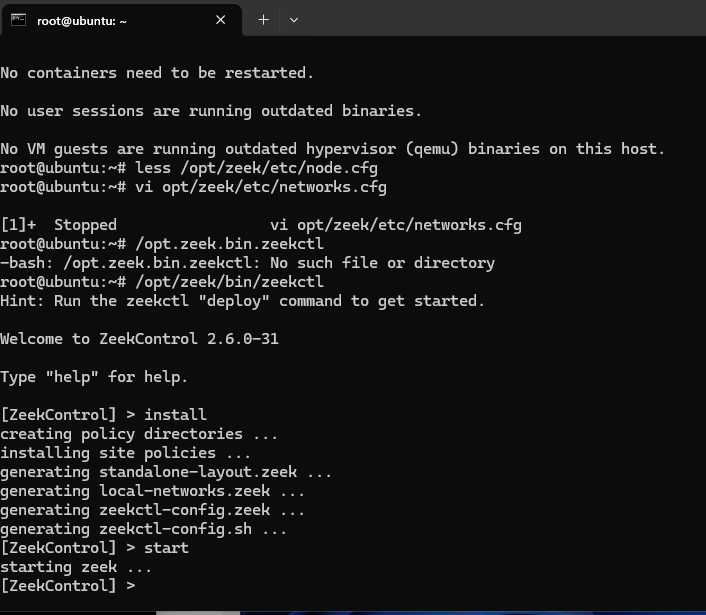
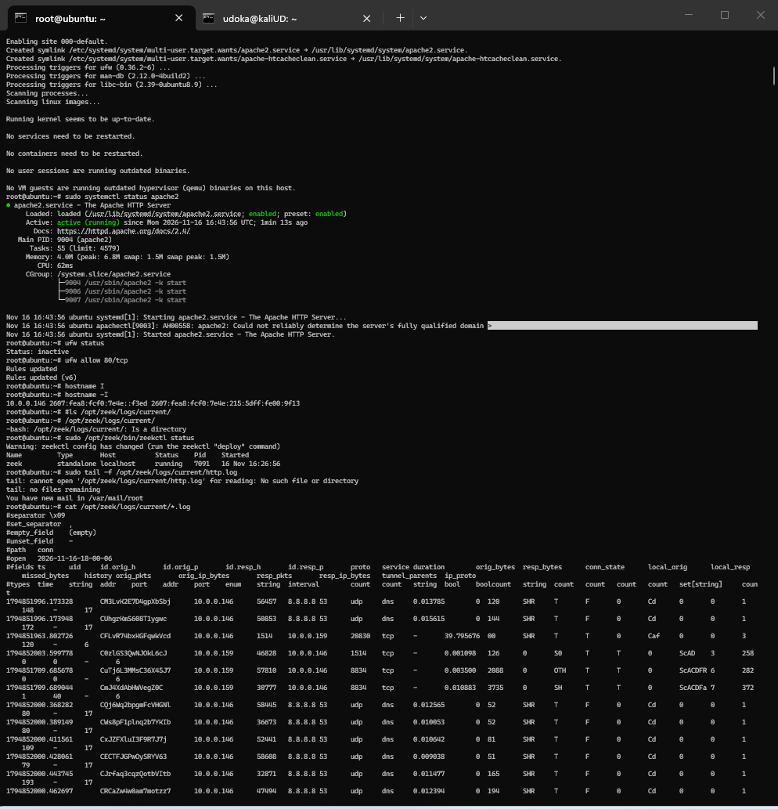
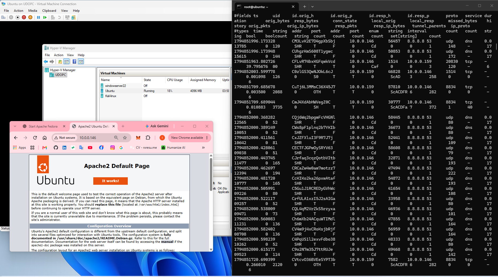
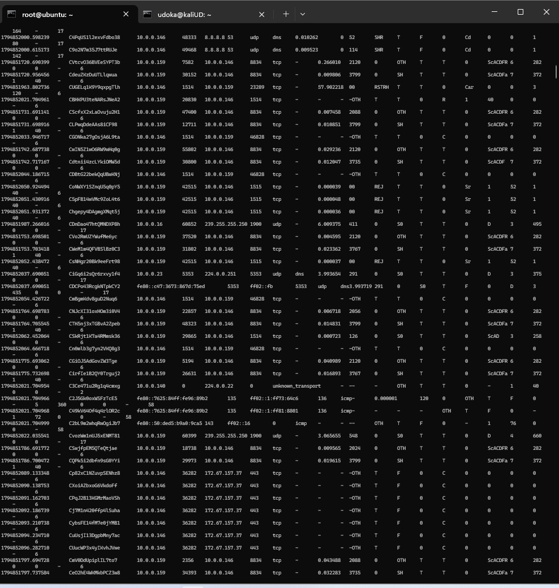
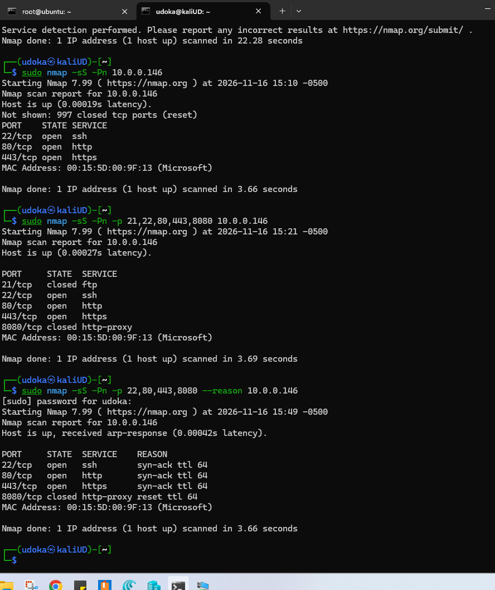
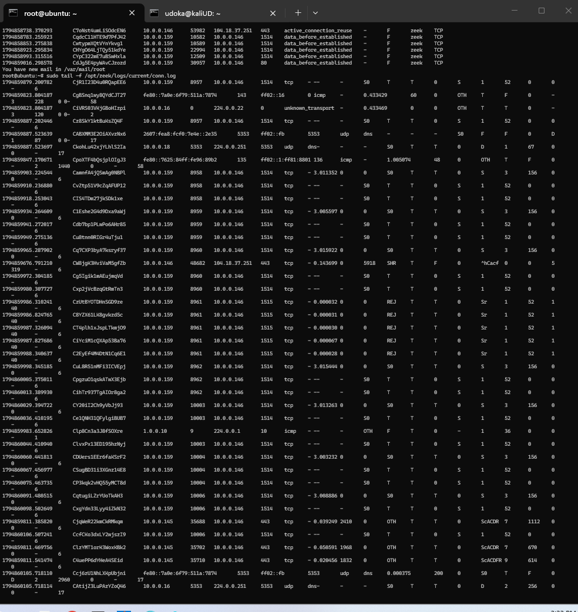

# Zeek network intrusion detection and traffic analysis

## Objective

Deploy Zeek on Ubuntu and investigate baseline traffic and controlled Nmap scanning in a Hyper-V lab.

## Evidence

### 1. Deploy Zeek

I installed Zeek policies and started the standalone monitoring service using ZeekControl.

### 2. Verify services

I verified Apache2 and Zeek were running on Ubuntu (10.0.0.146) and inspected connection logs. The HTTP log was not yet available.

### 3. Generate baseline traffic

I accessed the Apache default page from the Windows host and reviewed Zeek connection records, including DNS traffic.

### 4. Review network connections

I examined TCP and UDP records, including repeated connections from the Windows host and connection states such as REJ and OTH.

### 5. Perform controlled scanning

I ran Nmap SYN scans from Kali against Ubuntu. Ports 22, 80 and 443 returned SYN-ACK; ports 21 and 8080 were closed.

### 6. Monitor Kali traffic

I monitored conn.log and observed three TCP records from Kali (10.0.0.145) to Ubuntu on port 443 with state OTH. Other records showed S0 and REJ from the Windows host.

## Findings

- Nmap identified three open TCP ports on Ubuntu: 22, 80 and 443.
- Zeek recorded TCP, UDP, DNS and ICMP activity. S0 indicates a connection attempt without a reply; REJ indicates rejection; OTH indicates traffic observed without the initial SYN.
- Kali-to-Ubuntu traffic was visible, but the screenshots do not establish a matching Zeek record for every Nmap probe or a generated intrusion alert.
