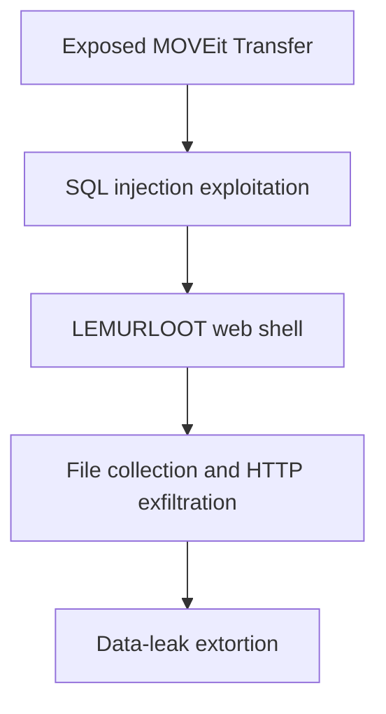

# Case Study 01 — MOVEit Transfer / Cl0p

| Report detail | Assessment |
|---|---|
| Prepared by | udodigwe |
| Incident period | May–June 2023 |
| Classification | Public-source threat intelligence assessment |
| Primary framework | MITRE ATT&CK Enterprise |

## 1. Executive summary

Cl0p exploited a SQL injection vulnerability in Progress MOVEit Transfer to gain unauthorized access to managed file transfer environments. Public reporting documents the LEMURLOOT web shell, sensitive file retrieval and data-leak extortion. The campaign exposed organizations and third parties whose information passed through vulnerable systems. Encryption is not established as the primary impact of this campaign. [1]

## 2. Threat actor and methodology

Cl0p is a financially motivated extortion operation associated with TA505 in CISA/FBI reporting. Its objective in this campaign was to steal sensitive data and pressure victims into paying. I assessed government advisories, vendor information and MITRE ATT&CK to reconstruct the campaign and distinguish documented behavior from inferred techniques. High confidence means explicitly reported; moderate means supported inference; low means insufficient evidence.

## 3. Attack vector and exposure

**Attack surface:** Internet-facing MOVEit Transfer web applications and the sensitive data repositories they serve.

**Vulnerability:** [CVE-2023-34362](https://nvd.nist.gov/vuln/detail/CVE-2023-34362) — SQL injection enabling unauthorized access to vulnerable MOVEit installations. Exposure alone does not establish compromise.

This campaign-level sequence is not a verified timeline for every victim. [1]

## 4. MITRE ATT&CK Enterprise mapping

| Tactic | Technique | Evidence and confidence |
|---|---|---|
| Initial Access | T1190 — Exploit Public-Facing Application | MOVEit exploitation — High |
| Persistence | T1505.003 — Web Shell | LEMURLOOT ASP.NET web shell — High |
| Defense Evasion | T1036.005 — Match Legitimate Resource Name or Location | human2.aspx resembles human.aspx; intent inferred — Moderate |
| Discovery | T1082 — System Information Discovery | Configuration retrieval capability; actual use unverified — Moderate |
| Discovery | T1083 — File and Directory Discovery | File retrieval does not prove directory enumeration — Low |
| Exfiltration | T1041 — Exfiltration Over C2 Channel | HTTP web-shell responses could carry files; channel classification inferred — Moderate |

Credential theft, lateral movement and encryption are not established for every victim. [1][2]

## 5. IOCs and threat hunting leads

| Indicator or signal | SOC investigation |
|---|---|
| `human2.aspx` | Inspect unexpected ASPX files in MOVEit application directories; validate against file integrity and process evidence. |
| `X-siLock-Comment` | Search retained HTTP telemetry for suspicious requests matching published indicators. |
| `Health Check Service` | Correlate suspicious account creation or deletion with identity and privilege audit logs. |
| CVE-2023-34362 | Inventory affected versions and verify remediation; this is an exposure indicator, not proof of compromise. |
| Abnormal file transfers | Correlate download volume, application file access and outbound traffic against normal behavior. |

Preserve web, application, database, identity and network logs; reconstruct file-access timelines and assess sensitive data exposure. A filename alone is not conclusive evidence.

## 6. Intelligence gaps and collection plan

| Unknown | Evidence needed |
|---|---|
| Target selection and reconnaissance | Historical requests, scanning patterns and external intelligence; retention may be incomplete. |
| Intrusion start and persistence | File timestamps, web logs and EDR timelines. |
| Additional accounts or lateral movement | Authentication, privilege and network telemetry from affected environments. |
| Exact files stolen | Application audits, file-access records and network egress; scope may remain incomplete. |
| Individual operator identities | Law-enforcement or intelligence attribution, generally unavailable publicly. |

## 7. Defensive recommendations

- **Immediate — Infrastructure / IR:** Inventory exposed installations, apply vendor remediation guidance and preserve evidence; verify patch status.
- **High — SOC / DFIR:** Hunt for web shells, suspicious accounts and unusual transfers; remove unauthorized artifacts, rotate affected secrets as warranted and document results.
- **High — Legal / privacy:** Assess affected datasets, third-party obligations and notification requirements.
- **Medium — Architecture / IAM:** Reduce unnecessary internet exposure and enforce least privilege for service accounts.
- **Ongoing — Security leadership:** Exercise third-party breach playbooks and monitor exposed software risk.

## 8. Reporting and conclusion

**Technical audience:** Report affected versions, validated IOCs, forensic timelines, file-access findings, containment and remediation evidence.

**Executive audience:** Communicate confidentiality risk, customer and third-party exposure, regulatory obligations, response costs and decisions required. Do not assume organizational compromise without internal evidence.

**Analytical conclusion:** A single public-facing application weakness can create widespread third-party data risk. Effective defense requires both patch verification and evidence-led investigation of possible data theft.

## 9. References

1. [CISA/FBI — Cl0p exploitation of MOVEit Transfer (AA23-158A)](https://www.cisa.gov/news-events/cybersecurity-advisories/aa23-158a)
2. [MITRE ATT&CK Enterprise](https://attack.mitre.org/matrices/enterprise/) — [T1190](https://attack.mitre.org/techniques/T1190/), [T1505.003](https://attack.mitre.org/techniques/T1505/003/)
3. [NVD — CVE-2023-34362](https://nvd.nist.gov/vuln/detail/CVE-2023-34362)
4. [Progress MOVEit — Vendor information](https://www.progress.com/moveit)
