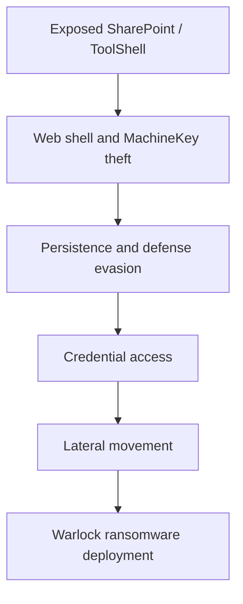

# Case Study 02 — SharePoint ToolShell / Storm-2603

| Report detail | Assessment |
|---|---|
| Prepared by | udodigwe |
| Incident period | July 2025 |
| Classification | Public-source threat intelligence assessment |
| Primary framework | MITRE ATT&CK Enterprise |

## 1. Executive summary

Multiple threat actors exploited authentication-bypass and remote-code-execution vulnerabilities in on-premises Microsoft SharePoint. Microsoft reported that Storm-2603 stole ASP.NET MachineKeys, established persistence, accessed credentials, moved laterally and deployed Warlock ransomware. This demonstrates how a public-facing application compromise can escalate into enterprise-wide disruption. Not all ToolShell activity is attributable to Storm-2603. [1][2]

## 2. Threat actor and methodology

Storm-2603 is a Microsoft-tracked actor associated with Warlock ransomware. The observed activity supports a ransomware monetization objective. I assessed Microsoft threat intelligence, Canadian Cyber Centre advisories and CISA malware analysis, mapping documented behavior to MITRE ATT&CK. High confidence denotes explicit reporting; moderate denotes supported inference; unknown denotes insufficient evidence.

## 3. Attack vector, vulnerabilities and exposure

**Attack surface:** Internet-facing on-premises SharePoint Server. Crafted requests targeting the SharePoint ToolPane endpoint enabled exploitation. SharePoint Online in Microsoft 365 was not affected by this vulnerability set. [1][3]

| CVE | Role in the vulnerability chain |
|---|---|
| CVE-2025-49704 | Earlier code-injection / remote-code-execution flaw |
| CVE-2025-49706 | Earlier authentication-bypass component |
| CVE-2025-53770 | Later remote-code-execution patch-bypass variant |
| CVE-2025-53771 | Later authentication-bypass patch-bypass variant |



Conceptual reconstruction of the reported Storm-2603 intrusion, not a victim-specific timeline. [1]

## 4. MITRE ATT&CK Enterprise mapping

| Tactic | Technique | Evidence and confidence |
|---|---|---|
| Initial Access | T1190 — Exploit Public-Facing Application | ToolShell exploitation — High |
| Execution | T1059.003 — Windows Command Shell | cmd.exe and batch scripts — High |
| Persistence | T1505.003 — Web Shell | spinstall0.aspx and variants — High |
| Persistence | T1053.005 — Scheduled Task | Scheduled-task persistence — High |
| Credential Access | T1003.001 — LSASS Memory | Mimikatz targeting LSASS — High |
| Discovery | T1033 — System Owner/User Discovery | whoami execution — High |
| Lateral Movement | T1021.002 — SMB/Windows Admin Shares | PsExec and Impacket; precise path varies — Moderate |
| Execution | T1047 — Windows Management Instrumentation | WMI command execution — High |
| Defense Evasion | T1562.001 — Disable or Modify Tools | Defender protections modified — High |
| Impact | T1486 — Data Encrypted for Impact | Warlock ransomware — High |

The reported campaign also involved IIS backdoor persistence and GPO-assisted ransomware distribution. [1][5]

## 5. IOCs and threat hunting leads

| Indicator or behavior | SOC investigation |
|---|---|
| `spinstall0.aspx` and variants | Inspect unexpected ASPX files under SharePoint layouts. |
| Published SHA-256 (below) | Compare against suspicious files using EDR or forensic tooling. |
| POST to `/_layouts/15/ToolPane.aspx` | Review IIS/WAF logs for abnormal Referer and response behavior. |
| `IIS_Server_dll.dll` | Investigate unexpected IIS modules and backdoor artifacts. |
| `debug_dev.js` | Investigate possible stolen configuration or MachineKey data. |
| `w3wp.exe` spawning `cmd.exe` or `powershell.exe` | Examine anomalous IIS process trees in EDR. |
| Mimikatz, LSASS access, PsExec and WMI | Correlate credential access and remote execution with identity and network telemetry. |

Published SHA-256 for `spinstall0.aspx` [3]:

```text
92bb4ddb98eeaf11fc15bb32e71d0a63256a0ed826a03ba293ce3a8bf057a514
```

Known artifacts are not exhaustive: the Canadian Cyber Centre reported an investigated intrusion without `spinstall0.aspx`. Absence of a known IOC does not rule out compromise. [2]

## 6. Intelligence gaps and collection plan

| Unknown | Evidence needed |
|---|---|
| Which servers were exploited and when? | IIS/WAF logs and EDR timelines. |
| Were MachineKeys exfiltrated? | Web-shell artifacts, response logs and forensic evidence. |
| Was a domain controller reached? | Authentication logs, SMB/WMI telemetry and AD changes. |
| What data was stolen? | DLP, network captures and file-access audits; scope may remain incomplete. |
| Who operated the infrastructure? | Infrastructure correlation and law-enforcement intelligence. |
| Which incidents involved Storm-2603? | Tooling, temporal and infrastructure clustering; attribution may remain provisional. |

## 7. Defensive recommendations

- **Immediate:** Inventory on-premises SharePoint, isolate potentially compromised instances, apply vendor updates and preserve logs.
- **Secrets and identity:** Rotate ASP.NET MachineKeys and relevant service credentials; review privileged accounts, tokens and suspicious sign-ins.
- **Detection engineering:** Hunt for ToolPane exploitation, anomalous IIS child processes, unexpected ASPX files, LSASS access, scheduled tasks, IIS modules and GPO changes.
- **Containment and recovery:** Investigate lateral movement, remove persistence, validate backups and test recovery before restoring service; continue enhanced monitoring.
- **Governance:** Assign remediation owners and deadlines, verify patch compliance and exercise the SharePoint compromise playbook. [1][2][3]

## 8. Reporting and conclusion

**Technical audience:** Provide affected builds, process trees, IIS requests, validated hashes, credential access and lateral movement findings, ATT&CK mappings and containment validation.

**Executive audience:** Explain affected business services, potential downtime, ransomware and data exposure, regulatory decisions, remediation progress and residual risk. Victim-specific losses cannot be established from public reporting.

**Analytical conclusion:** ToolShell shows why patching alone is insufficient after exploitation. Secret theft and established persistence require post-exploitation investigation, credential rotation and validated recovery.

## 9. References

1. [Microsoft Security — Disrupting active exploitation of on-premises SharePoint vulnerabilities](https://www.microsoft.com/en-us/security/blog/2025/07/22/disrupting-active-exploitation-of-on-premises-sharepoint-vulnerabilities/)
2. [Canadian Centre for Cyber Security — Threat detection for SharePoint vulnerabilities](https://www.cyber.gc.ca/en/news-events/threat-detection-sharepoint-vulnerabilities)
3. [Canadian Centre for Cyber Security — AL25-009 SharePoint vulnerability advisory](https://www.cyber.gc.ca/en/alerts-advisories/al25-009-vulnerability-impacting-microsoft-sharepoint-server-cve-2025-53770)
4. [CISA — SharePoint malware analysis report](https://www.cisa.gov/news-events/alerts/2025/08/06/cisa-releases-malware-analysis-report-associated-microsoft-sharepoint-vulnerabilities)
5. [MITRE ATT&CK Enterprise](https://attack.mitre.org/matrices/enterprise/)
