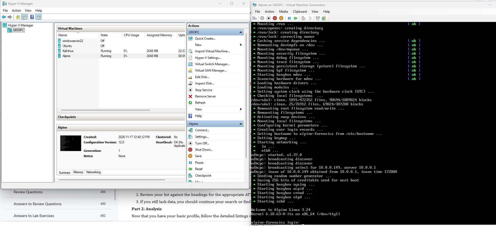
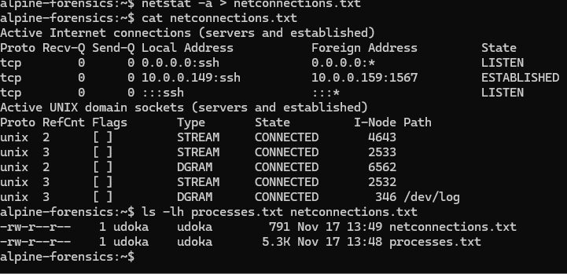
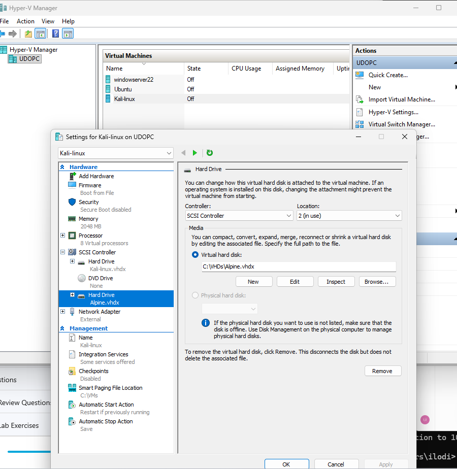
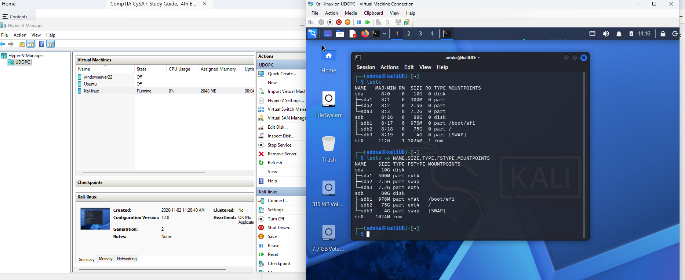
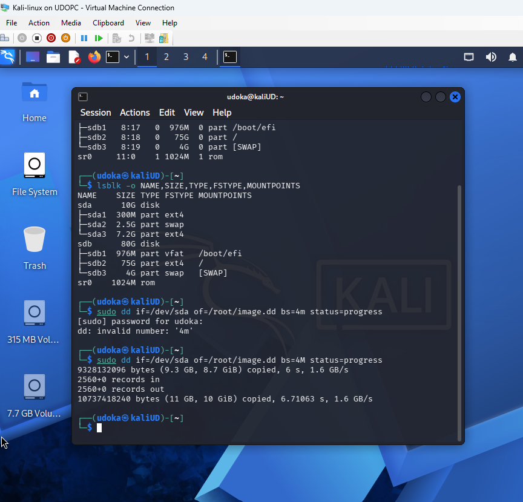
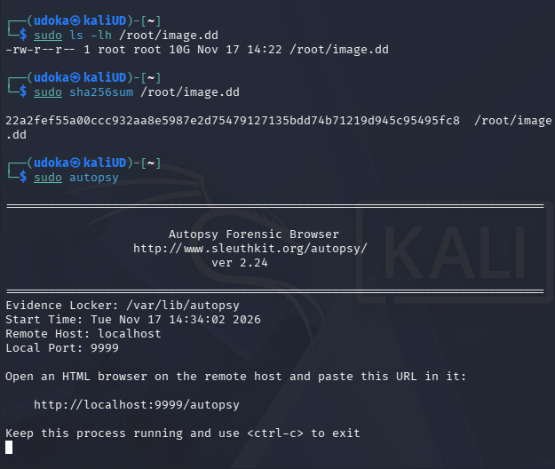
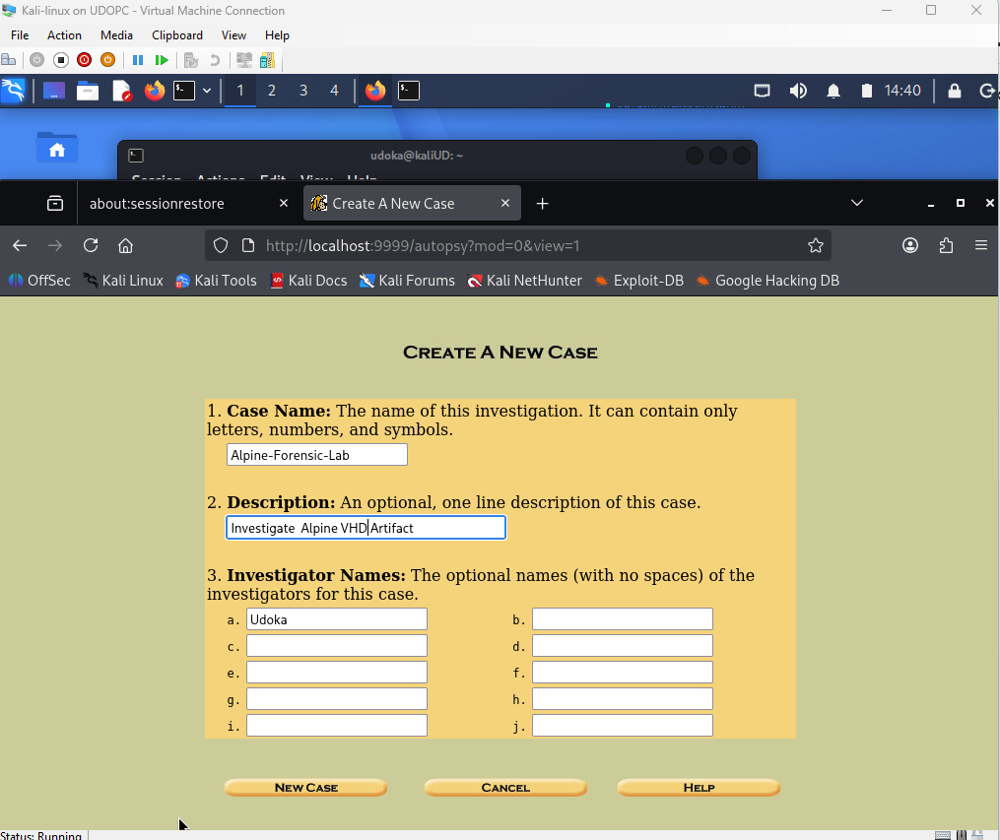
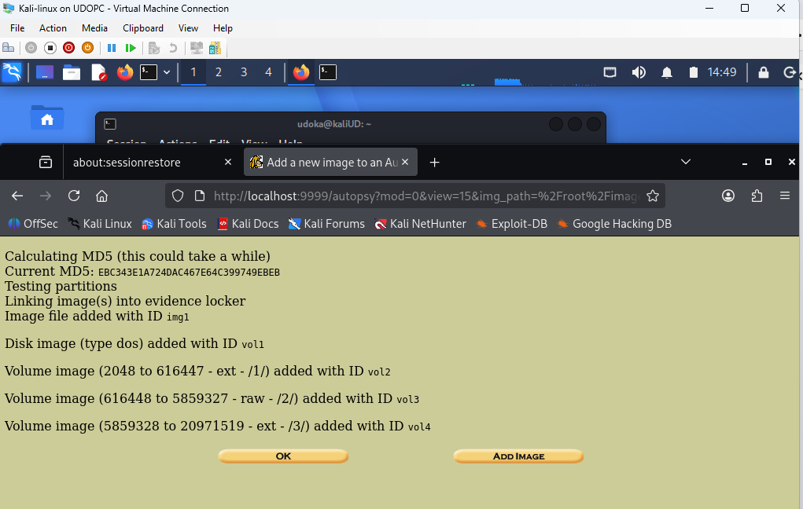
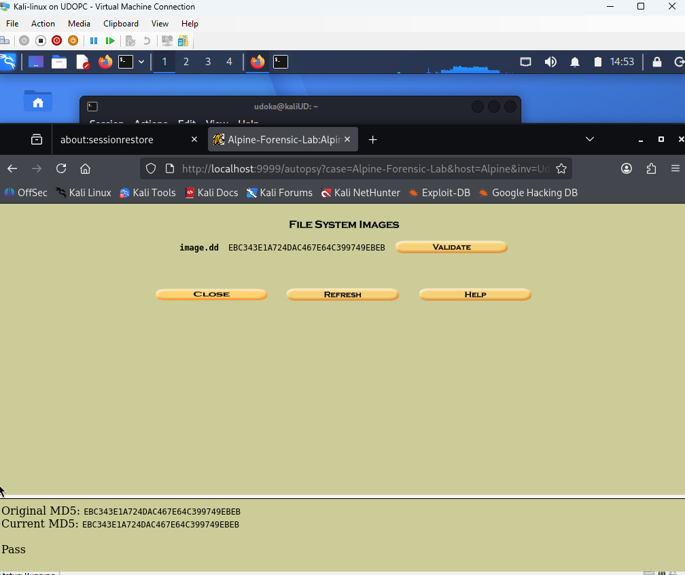
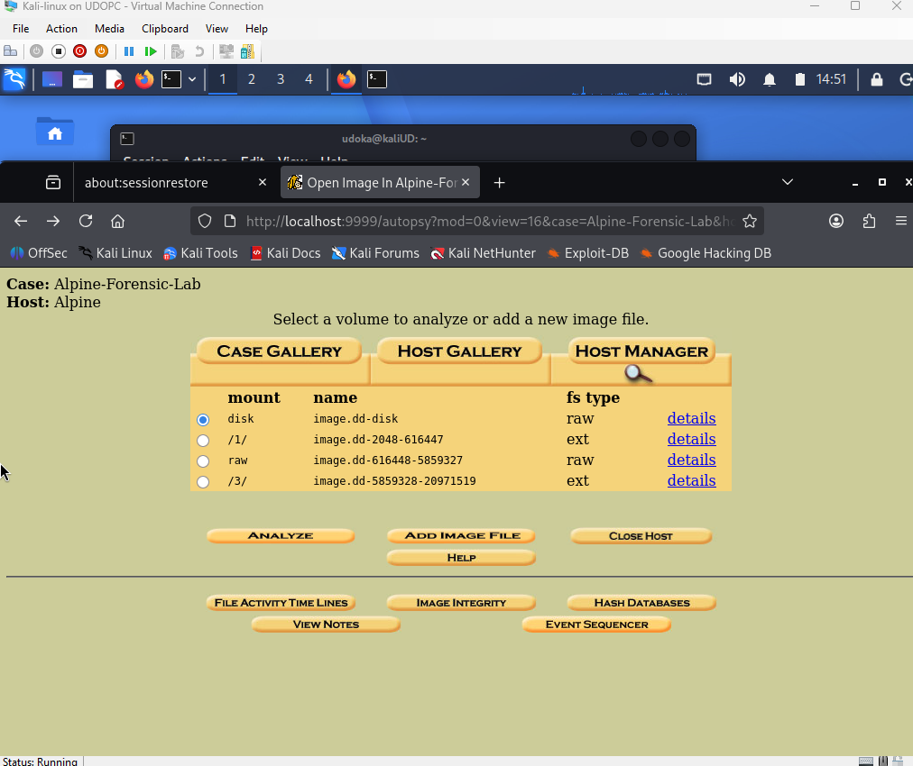

# Digital forensics — evidence and analysis

This controlled lab demonstrates the acquisition and integrity validation of an Alpine Linux disk image using Kali Linux and Autopsy.

## Investigation workflow

### 01 — Alpine Linux environment preparation

Configured and booted Alpine Linux in Hyper-V as the system under investigation.

### 02 — Live forensic artifact collection

Collected process and network connection artifacts in `processes.txt` and `netconnections.txt`. The network output shows an established SSH connection and listening sockets.

### 03 — Virtual disk attachment

Attached the Alpine VHDX to the Kali Linux virtual machine as a secondary disk for acquisition.

### 04 — Source disk identification

Identified the 10 GiB source disk `/dev/sda` and its three partitions, distinguishing it from the 80 GiB Kali system disk.

### 05 — Forensic disk acquisition

Acquired a raw disk image using `dd`. The completed operation copied 10,737,418,240 bytes (10 GiB) into `/root/image.dd`.

### 06 — SHA-256 hashing and Autopsy initialization

Confirmed the image size, generated a SHA-256 fingerprint and launched the Autopsy Forensic Browser.

### 07 — Autopsy case creation

Created the `Alpine-Forensic-Lab` investigation to organize the acquired disk evidence.

### 08 — Evidence import and partition discovery

Imported the raw image into Autopsy, calculated its MD5 hash and identified three partitions. The image was linked into the evidence locker.

### 09 — Evidence integrity validation

Validated the image against its recorded MD5 fingerprint. The original and current hashes matched, and Autopsy returned Pass.

### 10 — Forensic volume examination

Reviewed the available raw disk and partition entries in Autopsy, including two ext filesystem volumes and one raw partition, preparing them for deeper examination.

## Forensic findings

| Evidence | Observed result |
| --- | --- |
| Live artifacts | Process and network connection text files generated |
| Disk acquisition | 10 GiB raw image; 2,560 input and output records |
| SHA-256 | Image fingerprint generated |
| MD5 | `EBC343E1A724DAC467E64C399749EBEB` |
| Integrity validation | Original and current MD5 matched; Pass |
| Partition discovery | Three partitions: two ext volumes and one raw volume consistent with the identified swap partition |

## DFIR relevance

The workflow demonstrates evidence collection, disk acquisition, case management, integrity checking and preparation for offline filesystem investigation. In a production investigation, use write protection, record chain of custody and compare source and acquired-image hashes.

## Conclusion

Successfully acquired and imported the Alpine disk image and validated its recorded MD5 hash. This walkthrough serves as the lab evidence report; the screenshots do not establish a separate Autopsy report export, file recovery, detailed artifact examination or source-to-image hash verification.
